# Catch the AI: Complete Project Details

---

## 1. Quick Summary

Catch the AI is a fast web browser game where players review code written by artificial intelligence (AI) and identify hidden logical mistakes. You get 30 seconds per snippet to tap the exact line with the error before the countdown timer runs out.

Here is the factual summary of the project as it exists in the codebase today:

| Fact | Value | Location in Code |
| :--- | :--- | :--- |
| Project Name | Catch the AI | (index.html, line 6; config.js, line 2) |
| Software Version | 1.0.0 | (config.js, line 6; package.json, line 2) |
| Live Web Address | https://catchtheai.vercel.app/ | (config.js, line 10; index.html, line 17) |
| Git Repository | https://github.com/Pradeep-B28/Catch_The_AI.git | (git remote origin) |
| Active Git Branch | master | (git branch) |
| Total Project Files | 68 source files (82 files including docs/screenshots) | (project directory scan) |
| Total Source Lines | 8,998 lines of code and documentation | (project line count) |
| JavaScript Code | 6,175 lines across 34 files | (js/ and content/ directories) |
| Cascading Style Sheets | 1,712 lines across 3 files | (styles/ directory) |
| Challenge Packs | 2 packs: Beginner (b) and Developer (d) | (content/index.js, line 8) |
| Active Challenges | 20 challenges: 10 Beginner and 10 Developer | (content/pack-beginner.js; content/pack-developer.js) |
| Default Round Size | 8 challenges per round | (config.js, line 13) |
| Snippet Countdown | 30 seconds per snippet | (config.js, line 14) |
| Primary WhatsApp Sales Contact | +91 7550077725 | (config.js, line 21) |
| Parent Organization | Wrench Wise | (config.js, line 22; assets/logo.png) |
| Connected Program | Certification Program in AI-Powered Software Engineering & DSA | (config.js, line 18) |
| Last Update Date | Mon Nov 2, 2026 | (git log -n 1) |

---

## 2. Purpose

### The Problem It Solves
Artificial intelligence coding tools write code in seconds. The syntax looks clean, the variable names look smart, and the code compiles without syntax errors. However, AI code generators frequently introduce subtle logical bugs, such as loop boundary mistakes, inverted comparison checks, or unhandled negative numbers.

Beginners and students often accept AI-generated code without checking it. Catch the AI solves this problem by training players to read, inspect, and evaluate code with a critical eye. It teaches that being a software engineer requires understanding fundamental computer science principles so you can verify what AI writes.

### Who It Is For
1. **Beginner Mode Players:** School students, college freshers, parents, and career switchers with zero coding background. Snippets use everyday topics such as shopping discounts, cricket strike rates, and restaurant bill splitting. Each line includes an optional plain-English explanation note (content/pack-beginner.js, notes).
2. **Developer Mode Players:** Final-year engineering students, job seekers, and professional software developers. Snippets feature data structures and algorithms such as binary search, two-pointer palindromes, recursion base cases, hash maps, and sliding windows (content/pack-developer.js, challenges).
3. **Live Webinar Attendees:** Audience members in live Wrench Wise introductory workshops who play along during live presentations (js/presenter.js, startPresenterMode).
4. **Social Media Viewers:** Short-form video audiences on Instagram, YouTube Shorts, and LinkedIn who watch recorded gameplay demos (REEL_SCRIPT.md, lines 1 to 114).

### Why It Was Built
Catch the AI was built as an educational tool and interactive lead magnet for Wrench Wise (PROJECT_BRIEF.md, Section 1). A lead magnet is a free resource offered to prospective students to demonstrate educational quality and spark interest in a training program. Instead of filling out a standard inquiry form, prospective students play the game, experience their own knowledge gaps, and can tap one button to contact the admissions team with their score pre-filled (js/links.js, salesUrl).

### Connected Wrench Wise Program
The application directly connects to the **Certification Program in AI-Powered Software Engineering & DSA** (config.js, line 18; js/copy.js, COPY["cta.body"]).

---

## 3. How to Open It

### Live Address
The live web application is hosted on Vercel at:
https://catchtheai.vercel.app/

### Step-by-Step Instructions to Run on a Laptop
No external build tools, package installations, compilers, or databases are required.

1. **Step 1: Download or Clone the Repository**
   Open a terminal and run:
   ```bash
   git clone https://github.com/Pradeep-B28/Catch_The_AI.git
   cd Catch_The_AI
   ```
2. **Step 2: Start a Local Web Server**
   Web browsers block ES modules from loading over the `file://` protocol for security reasons. You must use a local HTTP server. Run either of these commands in your project folder:
   - Using Python 3:
     ```bash
     python -m http.server 8000
     ```
   - Using Node.js:
     ```bash
     npx serve .
     ```
3. **Step 3: Open in a Web Browser**
   Open Google Chrome, Mozilla Firefox, Apple Safari, or Microsoft Edge, and visit:
   ```
   http://localhost:8000/
   ```

### Special Link Options (URL Query Parameters)
The application supports special URL query parameters that unlock testing, presentation, and automation tools:

| URL Parameter | What It Does | Who Uses It | Location in Code |
| :--- | :--- | :--- | :--- |
| `?test=1` | Runs the automated 14-check self-test suite and displays a full pass or fail table on screen. | Developers and QA testers | (js/main.js, line 116; js/selftest.js, runSelfTest) |
| `?demo=1` | Launches an automated gameplay loop with an animated tap dot simulating human touch interactions. | Video creators recording social reels | (js/main.js, line 126; js/demo.js, startDemoMode) |
| `?demo=1&mode=d` | Runs automated demo mode using Developer mode snippets instead of Beginner mode. | Reel creators | (js/demo.js, line 20) |
| `?demo=1&n=3` | Sets demo mode to play a short 3-snippet round (accepts 3 to 8). Ideal for 30-second vertical reels. | Short-form video recording | (js/demo.js, line 22) |
| `?demo=1&theme=dark` | Forces dark theme during demo mode automation. | Reel recording | (js/demo.js, line 28) |
| `?demo=1&theme=light` | Forces light theme during demo mode automation. | Reel recording | (js/demo.js, line 28) |
| `?present=1` | Activates Presenter Mode for live Zoom or Google Meet webinars. Enforces enlarged 20px code font and enables keyboard hotkeys. | Workshop instructors | (js/main.js, line 133; js/presenter.js, startPresenterMode) |
| `?present=1&mode=d` | Runs Presenter Mode with Developer pack challenges. | Technical webinar hosts | (js/presenter.js, line 15) |
| `?preview=all` | Mounts all 20 active challenges one by one off-screen to measure font sizes and confirm zero text overflow. | Responsive design testing | (js/main.js, line 140; js/fitcheck.js, runFitCheck) |
| `?set=<ids>&beat=<score>` | Loads a custom challenge set shared by a friend (for example `?set=b01.b02.b03.b04.b05.b06.b07.b08&beat=6`). Displays head-to-head comparison upon completion. | Challenged players | (js/router.js, line 61; js/links.js, readChallenge) |

---

## 4. Every Screen and Every Feature

Catch the AI consists of three primary screens: the Home Screen, the Play Screen, and the Result Screen. Screen navigation is managed by a client-side router without full page reloads (js/router.js, navigate).

### Screen 1: Home Screen
The Home Screen introduces the game, lets players pick a difficulty mode, explains how to play, and showcases a live animated code preview.

#### What You See on Screen
- **Site Header:** Displays the Wrench Wise logo, a thin divider line, the title "Catch the AI", a sound mute button, and a theme switch button (index.html, lines 28 to 67).
- **Brand Gradient Bar:** A 3px gradient line colored emerald-to-teal-to-cyan sits along the bottom edge of the header (styles/base.css, lines 161 to 168).
- **Eyebrow Chip:** A green pill badge with the text "30 seconds a snippet" (js/screens/home.js, line 56).
- **Main Heading:** "Catch the AI" rendered with a vibrant gradient fill (js/screens/home.js, line 62).
- **Subtitle:** "AI wrote 8 pieces of code. Each one has a hidden mistake. How many can you catch?" (js/screens/home.js, line 67).
- **Challenge Banner (Conditional):** If opened via a challenge link, a green banner appears: "A friend caught 6 of 8 in Beginner mode. Can you beat that?" with a "Take the challenge" button (js/screens/home.js, lines 73 to 110).
- **Mode Selection Cards:** Two interactive cards:
  1. *Beginner Mode:* Tagline "Everyday code. No coding needed." Shows personal best score if played earlier (js/screens/home.js, line 130).
  2. *Developer Mode:* Tagline "Loops, hash maps, sorting and more." Shows personal best score if played earlier (js/screens/home.js, line 130).
- **How to Play Card:** Three numbered steps with inline icons: "Read what the code should do", "Tap the line with the mistake", and "See what AI got wrong" (js/screens/home.js, lines 170 to 200).
- **About These Snippets Disclosure:** An expandable accordion explaining that mistakes were curated and verified by Wrench Wise (js/screens/home.js, lines 203 to 215).
- **Free Live Session Card (Conditional):** Appears when `CONFIG.session.enabled` is true, providing webinar topic, date, and registration button (js/screens/home.js, lines 217 to 247).
- **Hero Editor Card:** A dark code editor card that loops through code typing, runs a scanline effect, glitches the bug line, and lands a green "CAUGHT" stamp (js/fx/hero.js, lines 26 to 61).
- **Ambient Floating Symbols:** Subtle programming symbols (`{ }`, `( )`, `;`, `=>`, `[ ]`, `</>`) gently float upward in the background (js/fx/ambient.js, lines 5 to 50).

#### Click Steps to Use
1. Visit the home page.
2. Tap either the "Beginner" card or "Developer" card to start a game round immediately.
3. Tap "About these snippets" to expand or collapse the informational note.
4. Tap the moon or sun icon in the top header to toggle between light and dark visual themes.
5. Tap the speaker icon to mute or unmute audio.

#### Phone vs Laptop Differences
- **Phone Viewport (390 x 844):** Single-column layout. The content stacks vertically. The hero editor card sits underneath the mode cards (styles/game.css, lines 670 to 677).
- **Laptop Viewport (1440 x 900):** Two-column grid layout (1.15fr to 0.85fr). The left column holds the titles, mode cards, and guide. The right column holds the sticky hero editor card, which stays fixed in place as the user scrolls (styles/game.css, lines 680 to 692).

---

### Screen 2: Play Screen
The Play Screen is where the active game takes place. The player inspects an AI-written code snippet and attempts to catch the mistake before the 30-second countdown ends.

#### What You See on Screen
- **Snippet Counter:** Shows progress, such as "Snippet 1 of 8" (js/screens/play.js, line 113).
- **Progress Dots:** 8 circular dots. The active snippet has an emerald pulsing ring. Completed snippets turn green for caught or red for missed (js/screens/play.js, lines 117 to 130).
- **Circular Timer Ring:** A 56px SVG countdown timer ring. The emerald-cyan ring drains counter-clockwise. The numeric seconds count down from 30 to 0. In the final 5 seconds, the ring and text switch to red and pulse once per second with an audible tick (js/screens/play.js, lines 134 to 192).
- **Task Card:** Displays uppercase label "THE TASK" and plain-English instructions describing what the code is supposed to do (js/screens/play.js, lines 195 to 204).
- **Code Editor Card:** Stylized dark IDE window. Includes:
  - Three macOS-style window dots (red, yellow, green appearance) (js/screens/play.js, lines 216 to 221).
  - Filename inferred from the function name, such as `finalPrice.js` (js/screens/play.js, line 224).
  - Cyan badge: "AI wrote this" (js/screens/play.js, line 233).
  - Line notes toggle button ("Line notes: On" or "Line notes: Off") for Beginner mode (js/screens/play.js, line 240).
- **Status Banner:** Displays animated shimmer text "AI is writing code" during typing, then switches to "Find the mistake" once typing finishes (js/screens/play.js, lines 256 to 262).
- **Code Editor Body:** Monospace code lines with line numbers in the gutter. Syntax elements are colored (keywords green, strings cyan, numbers yellow, functions light green, punctuation grey) (js/highlight.js, lines 48 to 69).
- **Line Notes:** In Beginner mode, an explanation note sits below each line describing what that line does in plain English (js/screens/play.js, lines 326 to 331).
- **Confirm Button:** Stretches across the full width. Disabled with text "Tap the line with the mistake" until a line is tapped, then changes to "Line X is the mistake" with full contrast (js/screens/play.js, lines 272 to 279).

#### What Happens Upon Reveal (The Catch or Miss Experience)
When the player taps Confirm or when the 30-second timer reaches 0, the reveal state triggers:
1. **If Caught:**
   - The tapped line flashes emerald green.
   - A tilted "CAUGHT" stamp lands on the line with a single bounce animation (js/fx/stamp.js, line 18).
   - A pleasant two-note rising chime plays (523 Hz then 784 Hz) (js/fx/sound.js, lines 120 to 148).
   - The progress dot turns green.
2. **If Wrong:**
   - The selected line receives a grey "Your pick" badge (js/screens/play.js, line 444).
   - The real bug line flashes red with a brief glitch shake animation (styles/game.css, lines 396 to 404).
   - A soft 160 Hz bass thud plays (js/fx/sound.js, lines 153 to 173).
   - The progress dot turns red.
3. **If Timed Out:**
   - The bug line highlights red with a "Time's up" badge.
4. **Fix Line Insertion:**
   - The faulty line is crossed out with a strikethrough, and its gutter shows a minus sign (for example `-2`) (js/screens/play.js, line 466).
   - A corrected fix line slides in directly below with an emerald plus sign (`+`) in the gutter (js/screens/play.js, lines 469 to 488).
5. **Reveal Panel:**
   - Appears below the code card.
   - Shows heading: "Caught it", "This one got past you", or "Time's up" (js/screens/play.js, lines 504 to 510).
   - Concept chip: e.g., "Percentages", "Boundary values", "Loop limits" (js/screens/play.js, line 515).
   - "Run it" Console: Dark terminal box proving the mistake with live call, expected return value, and AI buggy output (for example, `> finalPrice(1000, 10)`, `Should give 900`, `AI's code -9000`) (js/screens/play.js, lines 520 to 538).
   - "Why" explanation: Plain-English sentence explaining why the bug happened (js/screens/play.js, line 542).
   - Next Button: "Next snippet" (snippets 1 to 7) or "See my score" (snippet 8) (js/screens/play.js, line 550).

#### Phone vs Laptop Differences
- **Phone Viewport (390 x 844):** Single-column layout. The progress bar, task card, code editor, and reveal panel stack vertically. The font size auto-fits between 11px and 15px so code never scrolls horizontally (js/screens/play.js, line 27).
- **Laptop Viewport (1440 x 900):** Two-column grid (1.3fr to 0.9fr). The left column holds the code editor card. The right column holds the sticky timer, task card, confirm button, and reveal panel. The font size auto-fits between 11px and 16px (styles/game.css, lines 24 to 35).

---

### Screen 3: Result Screen
The Result Screen summarizes the player's performance after completing 8 snippets. It calculates ranks, highlights learning gaps, and provides sharing and conversion actions.

#### What You See on Screen
- **Hero Score Card:**
  - "New best" green badge if the score beats the previous local record (js/screens/result.js, line 80).
  - Label: "You caught" (js/screens/result.js, line 86).
  - Large numeric score counting up smoothly from 0 to final score over 800ms (js/screens/result.js, lines 352 to 369).
  - Total denominator: "of 8" (js/screens/result.js, line 97).
  - 8 Tally Dots: Pop in sequentially with an 80ms stagger. Hovering shows snippet title (js/screens/result.js, lines 103 to 115).
  - Rank Badge: Stamped badge displaying rank title: "Fresh Eyes", "Getting Sharp", "Sharp Reviewer", "Bug Hunter", or "AI's Toughest Reviewer" (js/score.js, lines 14 to 22).
  - Result Statement: "AI wrote all 8. You caught 6." (js/score.js, line 37).
  - Support Text: "AI writes code fast. Checking it still takes someone who knows the basics." (js/copy.js, COPY["result.support"]).
  - Average Catch Time: Displays average response time for caught snippets (for example, "Average catch time: 8.7 s") (js/screens/result.js, line 140).
  - Head-to-Head Comparison: If playing via a challenge link, displays outcome against a friend: "You caught 6. Your friend caught 4. You win this one." (js/score.js, line 48).
- **What Tripped You Up Card:** Shows up to 4 red tags representing concepts missed during the round (e.g. "Percentages", "Two pointers"). Hidden if score is 8 of 8 (js/screens/result.js, lines 155 to 177).
- **See All 8 Again Disclosure:** Expandable list containing all 8 played snippets with their titles, green Caught or red Missed status tags, and educational "why" notes (js/screens/result.js, lines 180 to 216).
- **Wrench Wise Course Card:** Lead conversion card:
  - Title: "Want to catch these every time?" (js/copy.js, COPY["cta.title"]).
  - Body: Explains how the course covers fundamentals like loops, conditions, and hash maps (js/copy.js, COPY["cta.body"]).
  - Primary Button: "Talk to us on WhatsApp" (pre-fills score and mode to sales WhatsApp) (js/screens/result.js, line 241).
  - Fallback Link: "Visit wrench-wise.com" with UTM tracking tags (js/screens/result.js, line 258).
- **Social Share Card:**
  - Size pills: "Status" (9:16 vertical 1080 x 1920) and "Post" (4:5 portrait 1080 x 1350) (js/share.js, lines 43 to 67).
  - "Share my score" button: Generates an image on canvas and opens native phone share sheet or downloads PNG (js/share.js, line 74).
  - "Send on WhatsApp" button: Opens WhatsApp web intent with challenge link (js/share.js, line 125).
  - "Copy challenge link" button: Copies deep link to clipboard and flashes "Copied" for 2 seconds (js/share.js, line 137).
- **Action Buttons:** "Play again" button and "Try Developer mode" / "Try Beginner mode" switch button (js/screens/result.js, lines 315 to 344).

#### Phone vs Laptop Differences
- **Phone Viewport (390 x 844):** Single vertical column; maximum width 640px (styles/game.css, lines 891 to 899).
- **Laptop Viewport (1440 x 900):** Two-column layout (1.15fr to 0.85fr). Left column contains the hero score card, review accordion, and action buttons. Right column contains tripped concepts, course CTA card, and social share card (styles/game.css, lines 901 to 940).

---

## 5. Every Control

Here is the complete table of every interactive control, button, input, toggle, and keyboard shortcut across the entire application:

| Control Label | Control Type | What It Does | Where It Sits on Screen | Location in Code |
| :--- | :--- | :--- | :--- | :--- |
| Mute sound / Unmute sound | Button (`#sound-btn`) | Toggles Web Audio sound synthesis on or off. Saves state to `localStorage.cta-muted`. | Top header, right side | (index.html, lines 37 to 47; js/main.js, line 26) |
| Toggle theme | Button (`#theme-btn`) | Switches between light mode and dark mode. Saves state to `localStorage.cta-theme`. | Top header, right side | (index.html, lines 48 to 63; js/main.js, line 77) |
| Wrench Wise Catch the AI | Link (`.header-brand`) | Navigates back to the Home Screen from any active screen. | Top header, left side | (index.html, lines 30 to 35; js/main.js, line 38) |
| Beginner | Button (`.mode-card[data-pack="b"]`) | Starts an 8-snippet round using Beginner challenges with line notes. | Home Screen, mode selection grid | (js/screens/home.js, line 128) |
| Developer | Button (`.mode-card[data-pack="d"]`) | Starts an 8-snippet round using Developer DSA challenges. | Home Screen, mode selection grid | (js/screens/home.js, line 128) |
| Take the challenge | Button (`.challenge-banner button`) | Starts a game round playing the exact challenge set shared by a friend. | Home Screen, challenge banner | (js/screens/home.js, line 95) |
| About these snippets | Disclosure (`summary`) | Expands or collapses details explaining the origin of snippet content. | Home Screen, informational section | (js/screens/home.js, line 206) |
| Save my seat | Link (`.session-btn`) | Opens registration URL for upcoming live webinar in a new browser tab. | Home Screen and Result Screen, session card | (js/screens/home.js, line 238) |
| Line notes: On / Off | Button (`.notes-toggle-btn`) | Toggles plain-English explanations underneath each line of code in Beginner mode. | Play Screen, code card title bar | (js/screens/play.js, line 237) |
| Code Card Click | Surface (`.code-card`) | Skips character-by-character typing animation to show full snippet immediately. | Play Screen, code editor card | (js/screens/play.js, line 370) |
| Code Line Rows | Radiogroup item (`.code-line-row`) | Selects a specific code line as the suspected bug. Updates confirm button. | Play Screen, code editor body | (js/screens/play.js, line 294) |
| Line X is the mistake | Button (`.confirm-btn`) | Locks in the selected line, stops timer, evaluates answer, and triggers reveal. | Play Screen, below code card | (js/screens/play.js, line 274) |
| Next snippet / See my score | Button (`.reveal-next-btn`) | Advances to the next snippet in the round, or opens Result Screen on snippet 8. | Play Screen, inside reveal panel | (js/screens/play.js, line 547) |
| See all 8 again | Disclosure (`summary`) | Expands or collapses review list of all 8 played snippets with answers and explanations. | Result Screen, below score card | (js/screens/result.js, line 183) |
| Talk to us on WhatsApp | Link (`.cta-whatsapp-btn`) | Opens WhatsApp chat to admissions contact with pre-filled score message. | Result Screen, course CTA card | (js/screens/result.js, line 240) |
| See the program | Link (`.cta-program-btn`) | Fallback button opening Wrench Wise website when sales WhatsApp is unset. | Result Screen, course CTA card | (js/screens/result.js, line 248) |
| Visit wrench-wise.com | Link (`.cta-website-link`) | Secondary link opening Wrench Wise main homepage with UTM tracking tags. | Result Screen, course CTA card | (js/screens/result.js, line 257) |
| Status | Pill Button (`.share-pill`) | Selects vertical 9:16 format (1080 x 1920) for Instagram Stories and WhatsApp Status. | Result Screen, share card | (js/share.js, line 43) |
| Post | Pill Button (`.share-pill`) | Selects portrait 4:5 format (1080 x 1350) for LinkedIn, Instagram, and X feeds. | Result Screen, share card | (js/share.js, line 48) |
| Share my score | Button (`.share-action-btn`) | Renders canvas image and invokes native Web Share sheet or downloads PNG. | Result Screen, share card | (js/share.js, line 74) |
| Send on WhatsApp | Link (`.share-action-btn`) | Opens WhatsApp share intent with text challenge and deep link. | Result Screen, share card | (js/share.js, line 125) |
| Copy challenge link | Button (`.share-action-btn`) | Copies self-contained challenge link to clipboard; displays "Copied" for 2 seconds. | Result Screen, share card | (js/share.js, line 137) |
| Play again | Button (`.result-action-buttons button`) | Restarts a new randomized 8-snippet round in the same difficulty mode. | Result Screen, bottom actions | (js/screens/result.js, line 318) |
| Try Developer / Beginner mode | Button (`.result-action-buttons button`) | Starts a new 8-snippet round switching to the alternate difficulty mode. | Result Screen, bottom actions | (js/screens/result.js, line 333) |
| ArrowDown | Keyboard Key | Moves selection down to the next code line during play. | Any active Play Screen | (js/screens/play.js, line 583) |
| ArrowUp | Keyboard Key | Moves selection up to the previous code line during play. | Any active Play Screen | (js/screens/play.js, line 589) |
| Enter | Keyboard Key | Confirms the currently selected line. | Any active Play Screen | (js/screens/play.js, line 593) |
| n, N, ArrowRight | Keyboard Key | Triggers "Next snippet" or "See my score" during reveal state. | Play Screen (during reveal) | (js/screens/play.js, line 573) |
| m, M | Keyboard Key | Toggles sound mute state on or off instantly. | Any active screen | (js/screens/play.js, line 567) |
| 1 to 9 (Presenter Mode) | Keyboard Key | Selects code line number 1 to 9 directly in Presenter Mode. | Presenter Mode (`?present=1`) | (js/presenter.js, line 57) |
| r, R (Presenter Mode) | Keyboard Key | Forces immediate answer reveal without selecting a line in Presenter Mode. | Presenter Mode (`?present=1`) | (js/presenter.js, line 62) |


---

## 6. One Full Journey

Here is a step-by-step walkthrough of one complete playthrough of Catch the AI, tracing exactly what the player sees on screen and what happens under the hood in the code:

### Step 1: Loading the Application
- **What Happens on Screen:** The player navigates to `https://catchtheai.vercel.app/`. The browser displays the white and emerald header with the Wrench Wise logo. In the background, programming symbols float upwards slowly. On the right side, the dark hero editor begins typing code snippet `b01` automatically.
- **What Happens in the Code:** The browser loads `index.html`. Line 87 executes `import "./js/main.js"`. The `init()` function inspects `window.location.search`. Seeing no query parameters, it calls `setupHeaderControls()`, reading `localStorage` for `cta-theme` (defaulting to light) and `cta-muted` (defaulting to unmuted) (js/main.js, lines 51 to 60). It calls `initAnalytics()`, and then invokes `router.init(container)`. The router mounts all three screens into memory and navigates to `"home"` (js/router.js, lines 54 to 73).

### Step 2: Selecting Difficulty Mode
- **What Happens on Screen:** The player reads the two mode cards. They tap the "Beginner" card, which shows "Everyday code. No coding needed."
- **What Happens in the Code:** The click listener on `.mode-card[data-pack="b"]` emits the event `pack:selected` with `{ packId: "b" }` (js/screens/home.js, line 159). The router executes `navigate("play", { packId: "b" })`. The router calls `homeScreen.leave()`, destroying the ambient symbol interval and the hero animation timers (js/screens/home.js, lines 265 to 279). It calls `playScreen.enter({ packId: "b" })` (js/router.js, lines 40 to 44).

### Step 3: Round Assembly
- **What Happens on Screen:** The home layout clears and the Play Screen instantly renders with the top bar reading "Snippet 1 of 8". The timer ring starts at 30.
- **What Happens in the Code:** `content.js` calls `buildRound("b")`. It retrieves the 10 active Beginner challenges from `content/pack-beginner.js`, excludes any with `retired: true`, shuffles them using `seededShuffle` with `Math.random`, picks the first 8, and sorts them stably by difficulty level (levels 1, then 2, then 3) (js/content.js, lines 54 to 65). In this session, the round selects: `b01`, `b02`, `b03`, `b04`, `b05`, `b06`, `b07`, and `b08`.

### Step 4: Snippet 1 (Catching the Percentage Bug)
- **What Happens on Screen:**
  - Task card displays: "Take 10% off a price. A ₹1,000 shirt should cost ₹900."
  - Code title bar displays `finalPrice.js`.
  - The AI typing animation prints the 4 lines character by character over 1.2 seconds while soft key ticks click.
  - The status banner switches to "Find the mistake". The timer ring starts counting down from 30 seconds.
  - Under line 2 (`let cut = price * off;`), the note explains: "Multiplies the price by the discount number."
  - The player taps line 2. Line 2 highlights with an emerald-cyan left border. The bottom button turns vibrant and reads "Line 2 is the mistake".
  - The player taps "Line 2 is the mistake" at 23.4 seconds remaining (after 6.6 seconds of inspection).
- **What Happens in the Code:**
  - `startTyping()` runs using `requestAnimationFrame`, appending characters to `editorBody` every 18 milliseconds and invoking `playKeyTick()` (js/fx/typing.js, lines 37 to 77).
  - When typing finishes, `createTimer()` starts using `performance.now()`.
  - The player tap executes `selectLineNumber(2)`. The confirm button changes `disabled = false`.
  - On confirm, `handleConfirm()` records the elapsed time (6.6 seconds), stops the timer, and evaluates `selectedLine === challenge.bugLine` (`2 === 2`, which evaluates to `true`).
  - An outcome object `{ id: "b01", result: "caught", seconds: 6.6, ... }` is emitted across the event bus (js/screens/play.js, lines 383 to 395).
  - Line 2 flashes green. `createStamp(bugRow, { text: "CAUGHT" })` mounts the green badge with a 200ms bounce (js/fx/stamp.js, lines 13 to 24).
  - `playCatchSound()` synthesizes a 523 Hz to 784 Hz sine arpeggio via the Web Audio API (js/fx/sound.js, lines 120 to 148).
  - Line 2 gutter shows `-2` and strikes out. Line 3 inserts `+ let cut = price * off / 100;`.
  - The reveal panel opens displaying concept chip "Percentages", the Run it console (`> finalPrice(1000, 10)`, `Should give 900`, `AI's code -9000`), and the educational why note.
  - The player taps "Next snippet".

### Step 5: Snippet 2 (Catching the Bill Splitter Bug)
- **What Happens on Screen:** Snippet 2 loads (`b02` Bill splitter). Task: "Split a ₹1,200 bill between you and 3 friends. Each person pays ₹300." Player catches line 3 (`return bill / friends;` should be `return bill / people;`) in 4.2 seconds. Green CAUGHT stamp lands. Player taps "Next snippet".
- **What Happens in the Code:** The second dot turns green. `recordedOutcomes` stores the second catch.

### Step 6: Snippet 3 (Making a Mistake on Pass or Fail)
- **What Happens on Screen:**
  - Snippet 3 loads (`b03` Pass or fail). Task: "The pass mark is 35. A student with exactly 35 should pass."
  - Line 2 reads: `if (marks > 35) {`
  - Line 3 reads: `  return "Pass";`
  - The player accidentally taps line 3 and clicks "Line 3 is the mistake".
  - Line 3 receives a grey "Your pick" tag.
  - Line 2 shakes with a red glitch animation.
  - A soft 160 Hz bass thud plays.
  - Progress dot 3 turns red.
  - Fix line slides in below line 2: `+ if (marks >= 35) {`.
  - The Run it console explains: `result(35)` should give `"Pass"`, but AI's code gave `"Fail"`.
  - The why note explains: `"More than 35" leaves out 35 itself. It needs "35 or more", written as >=.`
  - The player taps "Next snippet".
- **What Happens in the Code:** `selectedLine === challenge.bugLine` (`3 === 2`) evaluates to `false`. Result is marked `"wrong"`. Outcome is emitted and pushed to `pastResults` (js/screens/play.js, lines 439 to 451).

### Step 7: Snippets 4 to 8
- **What Happens on Screen:** The player completes snippets 4 through 8 (`b04` to `b08`). They catch `b04`, `b05`, `b06`, and `b07`, but miss `b08` due to a 30-second timeout.
- **What Happens in the Code:** On snippet 8 reveal, the button changes from "Next snippet" to "See my score" (js/screens/play.js, line 550).

### Step 8: Arriving at the Result Screen
- **What Happens on Screen:**
  - The player clicks "See my score".
  - The score number rolls up from 0 to 6 over 0.8 seconds.
  - 8 tally dots pop in one after another (6 green dots, 2 red dots).
  - A green stamped badge lands: "Sharp Reviewer".
  - Result line displays: "AI wrote all 8. You caught 6."
  - Average catch time displays: "Average catch time: 7.4 s".
  - "What tripped you up" card displays red chips: "Boundary values" and "Conditions".
  - Course CTA card offers: "Want to catch these every time? The Certification Program in AI-Powered Software Engineering & DSA covers the basics behind these mistakes..."
  - The player clicks "Talk to us on WhatsApp".
- **What Happens in the Code:**
  - `playScreen.leave()` cleans up event listeners.
  - `router.navigate("result", ...)` executes (js/screens/play.js, line 802).
  - `score.rank(6, 8)` calculates percentage 75%, returning `"Sharp Reviewer"` (js/score.js, line 19).
  - `missedConcepts(results)` extracts the two missed categories: `["Boundary values", "Conditions"]` (js/score.js, lines 61 to 85).
  - `playResultFanfare(false)` triggers the 3-note celebration arpeggio (js/fx/sound.js, lines 179 to 200).
  - Local record in `localStorage.cta-best` is updated to `{ "b": 6 }` (js/screens/result.js, line 64).
  - Clicking WhatsApp triggers `salesUrl()`, generating `https://wa.me/917550077725?text=...` with the pre-filled message, and emitting `whatsapp:click` for GA4 tracking (js/links.js, lines 106 to 126; js/analytics.js, lines 55 to 58).

---

## 7. The Logic

Here is every algorithm, formula, scoring rule, and calculation used in the application.

### 1. Seeded Pseudorandom Number Generator (Mulberry32)
- **What it does in plain words:** Computers generate random numbers using mathematical formulas. Mulberry32 takes an initial starting number (called a seed) and produces an infinite, repeatable sequence of decimal numbers between 0 and 1. If you give it the same seed, it will always output the exact same sequence of numbers.
- **Worked example:**
  Given seed `20261103` (representing November 3, 2026):
  1. Internal variable `a = 20261103 >>> 0` (converted to an unsigned 32-bit integer).
  2. First trigger adds constant `0x6D2B79F5` (1,831,565,813 in base-10).
  3. Bit shifts and multiplications mix the bits thoroughly.
  4. The result is divided by `4294967296` (2 raised to the 32nd power).
  5. The first generated number is exactly `0.4568864756729454` (js/selftest.js, lines 472 to 475).
- **Why this was chosen:** It is tiny (only 12 lines of plain JavaScript), has zero dependencies, and produces uniform statistical distribution. It allows challenge sets to be shared across URLs deterministically.
- **How fast it is:** Big-O notation: O(1) constant time. Explained in plain words: It executes in less than 2 nanoseconds because it only performs four basic arithmetic operations.
- **Where it lives in code:** (js/rng.js, lines 10 to 18).

### 2. Deterministic Fisher-Yates Array Shuffle
- **What it does in plain words:** Takes a list of items and shuffles them into a random order such that every possible permutation is equally likely.
- **Worked example:**
  Shuffle 3 challenge IDs `["b01", "b02", "b03"]`:
  1. Starts at the last item (index 2: `"b03"`).
  2. Picks a random slot `j` between 0 and 2. Suppose `j = 0`. Swaps `"b03"` with `"b01"`. The array is now `["b03", "b02", "b01"]`.
  3. Moves to index 1 (`"b02"`). Picks a random slot `j` between 0 and 1. Suppose `j = 1`. Swaps with itself.
  4. Loop completes. Result array is perfectly randomized without bias.
- **Why this was chosen:** Standard naive sorting (like `array.sort(() => Math.random() - 0.5)`) is mathematically biased and unfair. Fisher-Yates guarantees complete statistical randomness.
- **How fast it is:** Big-O notation: O(N) linear time, where N is the number of challenges (8 to 20). Runs in less than 5 microseconds.
- **Where it lives in code:** (js/rng.js, lines 28 to 38).

### 3. Round Generation and Level Sorting
- **What it does in plain words:** Takes all challenges in a pack, filters out retired challenges, shuffles them randomly, slices the required round size (8 snippets), and then sorts them by difficulty level so players face easy challenges before hard ones.
- **Worked example:**
  1. 10 Beginner challenges (`b01` to `b10`) are filtered. All 10 are active.
  2. The 10 are shuffled into random order: `[b07, b02, b09, b01, b05, b08, b04, b03, b06, b10]`.
  3. The first 8 are sliced: `[b07, b02, b09, b01, b05, b08, b04, b03]`.
  4. JavaScript's stable sort orders them by `level` ascending:
     - Level 1 items (`b02`, `b01`, `b05`, `b04`, `b03`) appear first in their shuffled relative order.
     - Level 2 items (`b07`, `b09`, `b08`) follow next.
  5. The player experiences a smooth learning curve from level 1 to level 2.
- **Why this was chosen:** Keeps rounds fresh and replayable while preventing a player from facing a brutal difficulty spike on snippet 1.
- **How fast it is:** Big-O notation: O(N log N) where N = 8. Finishes in less than 10 microseconds.
- **Where it lives in code:** (js/content.js, lines 54 to 65).

### 4. Monospace Canvas Font Auto-Fit Algorithm
- **What it does in plain words:** Calculates the exact font size (between 11px and 16px) needed to make the longest code line fit within the player's screen width, preventing any horizontal code wrapping or awkward horizontal scrollbars.
- **Worked example:**
  - Phone screen width: 390px.
  - Available code area width: `390 - 32 (page margins) - 46 (gutter) - 24 (card padding) = 288px`.
  - Challenge `d02` has longest line: `const m = Math.floor((lo + hi) / 2);` (40 characters).
  - An off-screen HTML5 canvas measures line width at 15px: 360px (exceeds 288px).
  - Measures at 14px: 336px (exceeds 288px).
  - Measures at 13px: 312px (exceeds 288px).
  - Measures at 12px: 288px (fits exactly).
  - The algorithm applies `font-size: 12px` to `.code-editor-body`.
- **Why this was chosen:** Mobile code editors look broken when lines wrap or force users to scroll sideways to spot a bug. Canvas `measureText()` measures font geometry with sub-pixel precision before the browser paints.
- **How fast it is:** Big-O notation: O(K) where K is the number of font steps (at most 6 iterations). Finishes in less than 0.2 milliseconds.
- **Where it lives in code:** (js/screens/play.js, lines 26 to 49).

### 5. Precision Drift-Free Stopwatch and Countdown Timer
- **What it does in plain words:** Tracks the 30-second countdown using hardware-clock timestamps rather than interval counts. Pauses cleanly when the browser tab is hidden and resumes when the tab returns.
- **Worked example:**
  1. When snippet typing finishes, `timer.start()` records `startTime = performance.now() / 1000` (e.g. 104.250 seconds).
  2. If the user switches tabs for 4 seconds, `timer.pause()` records `pauseStart = 106.000`. On returning, `resume()` adds `110.000 - 106.000 = 4.000` to `totalPaused`.
  3. When calculating status:
     `active = clock() - startTime - totalPaused = 112.500 - 104.250 - 4.000 = 4.250 seconds`.
     `remaining = max(0, 30 - 4.250) = 25.750 seconds`.
     `secondsShown = Math.ceil(25.750) = 26 seconds`.
- **Why this was chosen:** Standard JavaScript `setInterval(..., 1000)` drifts by multiple seconds when mobile processors throttle background tabs or battery saver is active. Measuring difference in `performance.now()` guarantees exact timekeeping.
- **How fast it is:** Big-O notation: O(1) constant time per animation frame.
- **Where it lives in code:** (js/timer.js, lines 21 to 91).

### 6. Syntax Tokenizer and Safe DOM Highlighter
- **What it does in plain words:** Takes a line of code as raw text, breaks it into recognizable tokens (keywords, numbers, strings, function names, punctuation), and builds styled HTML elements safely without using dangerous `innerHTML`.
- **Worked example:**
  Input string: `let cut = price * off;`
  - Token 1: `let` -> Keyword set match -> creates `<span class="syn-keyword">let</span>`.
  - Token 2: ` ` -> Whitespace -> creates text node `" "`.
  - Token 3: `cut` -> Identifier -> creates `<span class="syn-text">cut</span>`.
  - Token 4: ` = ` -> Punctuation -> creates `<span class="syn-punct"> = </span>`.
  - Token 5: `price * off;` -> tokenized similarly.
- **Why this was chosen:** Third-party highlighting packages (like Prism or Highlight.js) weigh over 50 KB and require build tools. This custom tokenizer is only 88 lines and uses `textContent` to prevent Cross-Site Scripting (XSS) security vulnerabilities.
- **How fast it is:** Big-O notation: O(L) where L is the character length of the code line (at most 42 characters). Finishes in 0.05 milliseconds per line.
- **Where it lives in code:** (js/highlight.js, lines 31 to 88).

### 7. AI Character-by-Character Typing Formula
- **What it does in plain words:** Types code lines smoothly onto the screen, adjusting typing speed based on snippet length so every snippet finishes typing in roughly 1.6 seconds.
- **Worked example:**
  - Formula: `charIntervalMs = min(18, max(4, floor(1600 / totalChars)))`.
  - If a snippet has 160 characters: `floor(1600 / 160) = 10 ms per character`.
  - If a short snippet has 60 characters: `min(18, floor(1600 / 60)) = 18 ms per character` (capped at 18ms so it never feels sluggish).
- **Why this was chosen:** Fixed-delay typing causes long snippets to take 5 seconds to load, making players impatient. Dynamic speed ensures snappy pacing regardless of snippet length.
- **How fast it is:** Big-O notation: O(C) where C is the character count.
- **Where it lives in code:** (js/fx/typing.js, lines 36 to 38).

### 8. Web Audio Procedural Sound Synthesis Formulas
- **What it does in plain words:** Generates game sound effects using mathematical sound waves synthesized in real time, avoiding any external `.mp3` or `.wav` audio files.
- **Worked example:**
  - **Catch chime:** Triggers two sine wave oscillators in succession:
    Note 1: Frequency = 523 Hz (Musical note C5), gain ramps from 0.2 down to 0.001 over 120ms.
    Note 2: Frequency = 784 Hz (Musical note G5), gain ramps from 0.25 down to 0.001 over 150ms.
  - **Miss thud:** Triangle wave at 160 Hz (deep tone), gain ramps from 0.25 to 0.001 over 180ms.
  - **Timer warning:** 880 Hz sine click (A5), duration 50ms, repeated once per second when remaining time is 5 seconds or less.
- **Why this was chosen:** Zero bytes of audio assets to download, zero network delay, and instant playback on mobile devices.
- **How fast it is:** Big-O notation: O(1) constant time instruction sent to the browser audio hardware thread.
- **Where it lives in code:** (js/fx/sound.js, lines 67 to 214).

### 9. Score Percentage and Rank Determination
- **What it does in plain words:** Compares the player's caught score against the round total and awards an educational title.
- **Threshold Rules:**
  - `score / total >= 1.00` (100%): **"AI's Toughest Reviewer"**
  - `score / total >= 0.85` (85% to 99%): **"Bug Hunter"**
  - `score / total >= 0.60` (60% to 84%): **"Sharp Reviewer"**
  - `score / total >= 0.35` (35% to 59%): **"Getting Sharp"**
  - `score / total < 0.35` (0% to 34%): **"Fresh Eyes"**
- **Worked example for 8-snippet round:**
  - 8 of 8 = AI's Toughest Reviewer
  - 7 of 8 (87.5%) = Bug Hunter
  - 5 or 6 of 8 (62.5% to 75%) = Sharp Reviewer
  - 3 or 4 of 8 (37.5% to 50%) = Getting Sharp
  - 0, 1, or 2 of 8 (0% to 25%) = Fresh Eyes
- **Why this was chosen:** Encouraging, professional tone that never insults the user, adhering strictly to Project Rule 6.
- **How fast it is:** Big-O notation: O(1) constant time comparison.
- **Where it lives in code:** (js/score.js, lines 14 to 22).

### 10. Result and Head-to-Head Sentence Generation
- **What it does in plain words:** Formulates grammatical, encouraging English sentences summarizing results and comparing friend scores.
- **Worked example:**
  - If score is 0 of 8: `"AI wrote all 8. This time, every mistake got past you."` (js/score.js, line 32).
  - If score is 6 of 8: `"AI wrote all 8. You caught 6."` (js/score.js, line 37).
  - If score is 8 of 8: `"AI wrote all 8. You caught every one."` (js/score.js, line 35).
  - If you score 6 and challenged friend scored 4: `"You caught 6. Your friend caught 4. You win this one."` (js/score.js, line 48).
  - If you score 5 and friend scored 5: `"You both caught 5. It's a tie."` (js/score.js, line 51).
- **Where it lives in code:** (js/score.js, lines 30 to 54).

### 11. Missed Concept Deduplication
- **What it does in plain words:** Gathers all missed challenges from the round, extracts their computer science concept labels, removes duplicates, and caps the list at 4 items in chronological order.
- **Worked example:**
  Player misses snippets with concepts: `["Loop limits", "Conditions", "Loop limits", "Hash maps", "Percentages", "Sorting"]`.
  1. "Loop limits" is added.
  2. "Conditions" is added.
  3. "Loop limits" is skipped because it was already seen.
  4. "Hash maps" is added.
  5. "Percentages" is added.
  6. The list has reached 4 items, so the loop terminates immediately.
  Result output: `["Loop limits", "Conditions", "Hash maps", "Percentages"]`.
- **Where it lives in code:** (js/score.js, lines 61 to 85).

### 12. Average Catch Time Calculation
- **What it does in plain words:** Sums the response times in seconds for all caught snippets and divides by the number of caught snippets. Rounded to 1 decimal place. Returns null if 0 snippets were caught.
- **Worked example:**
  Recorded catch times: `[4.2, 9.9, 12.0]` seconds.
  Sum = `26.1`. Average = `26.1 / 3 = 8.7 seconds`. Displays: `"Average catch time: 8.7 s"`.
- **Where it lives in code:** (js/score.js, lines 93 to 98).

### 13. Challenge Link Serialization and Parsing
- **What it does in plain words:** Encodes an array of challenge IDs and a target score into a URL query parameter string, and validates that an incoming link is well-formed and safe.
- **Worked example:**
  - Serializing: `challengeLink("https://catchtheai.vercel.app", ["b01", "b02", "b03"], 2)` produces:
    `https://catchtheai.vercel.app/?set=b01.b02.b03&beat=2`.
  - Parsing validation checks (all must pass):
    1. Query has `set` parameter (js/links.js, line 58).
    2. Number of IDs is between 3 and 20 (js/links.js, line 65).
    3. Every ID is lowercase alphanumeric only (`/^[a-z0-9]+$/`) (js/links.js, line 71).
    4. No duplicate IDs are present (js/links.js, line 72).
    5. All IDs belong to the same pack (js/links.js, line 80).
    6. If `beat` is provided, it is an integer between 0 and the number of IDs (js/links.js, line 90).
- **Where it lives in code:** (js/links.js, lines 24 to 95).

### 14. Social Share Card Dynamic Layout and Canvas Rendering
- **What it does in plain words:** Renders a downloadable PNG graphic on an invisible HTML5 canvas element with brand typography, gradient fills, and an editor card illustration.
- **Worked example for Status format (1080 x 1920 pixels):**
  1. Allocates off-screen canvas `1080 x 1920`.
  2. Fills 135-degree background gradient `#ECFDF5` to `#FFFFFF` to `#ECFEFF`.
  3. Draws 8px brand top bar (`#059669` to `#06B6D4`).
  4. Respects mobile safe zones by placing content starting at vertical offset `Y = 250px`.
  5. Renders Wrench Wise logo and title.
  6. Renders large score number (`130px font`) with gradient fill, followed by `"/8"`.
  7. Draws rounded pill badges for Mode and Rank.
  8. Illustrates a dark editor card containing the code lines of the player's last caught challenge, stamping `CAUGHT` over the fixed bug line.
  9. Exports via `canvas.toBlob(...)` as `image/png`.
- **Where it lives in code:** (js/shareImage.js, lines 20 to 178).

---

## 8. The Data

### Where the Data Lives
All game challenge data lives in the `content/` folder inside modular JavaScript files:
- `content/pack-beginner.js` (Beginner Mode)
- `content/pack-developer.js` (Developer Mode)
- `content/index.js` (Registry aggregating all packs)
- `content/SCHEMA.md` (Specification defining field requirements)

### Total Items in the Data
There are currently **20 active challenges**:
- **10 Beginner challenges:** IDs `b01` through `b10`.
- **10 Developer challenges:** IDs `d01` through `d10`.
- There are currently 0 retired challenges in the active packs.

### Complete Data Dictionary

#### Pack Level Fields (content/SCHEMA.md, lines 13 to 23)
| Field | Data Type | Purpose | Example from App |
| :--- | :--- | :--- | :--- |
| `id` | String | Single lowercase character identifying the pack. | `"b"` (Beginner) or `"d"` (Developer) |
| `name` | String | Display title shown on the home mode selection card. | `"Beginner"` |
| `tagline` | String | Short explanatory subtitle shown beneath pack name. | `"Everyday code. No coding needed."` |
| `language` | String | Programming language. Must always be `"javascript"`. | `"javascript"` |
| `packVersion` | Integer | Version number incremented whenever challenges are updated. | `1` |
| `challenges` | Array of Objects | List of challenge scenario objects. Minimum 8 active. | Array of 10 challenge objects |

#### Challenge Level Fields (content/SCHEMA.md, lines 24 to 43)
| Field | Data Type | Purpose | Example from App (`b01`) |
| :--- | :--- | :--- | :--- |
| `id` | String | Unique identifier starting with pack letter followed by digits. Never changed or reused. | `"b01"` |
| `level` | Integer (1 to 3) | Difficulty level. 1 is easy, 2 is medium, 3 is hard. Rounds sort by level. | `1` |
| `title` | String | Short descriptive title of the challenge. | `"Discount calculator"` |
| `task` | String | Plain-English specification of what the code is intended to compute. | `"Take 10% off a price. A ₹1,000 shirt should cost ₹900."` |
| `code` | Array of Strings | The AI's buggy code, line by line. Max 42 characters per line, 3 to 14 lines total. | `["function finalPrice(price, off) {", "  let cut = price * off;", "  return price - cut;", "}"]` |
| `notes` | Array of Strings (Optional) | Line-by-line plain English explanation of what each line does. Must match code line count. | `["Takes a price...", "Multiplies...", "Gives back...", ""]` |
| `bugLine` | Integer | 1-based index pointing to the exact line containing the bug. | `2` |
| `fix` | String | Replacement code string that fixes the bug on `bugLine`. Must preserve indentation. | `"  let cut = price * off / 100;"` |
| `test.call` | String | JavaScript invocation string that exposes the mistake. | `"finalPrice(1000, 10)"` |
| `test.expected` | String | Correct JSON return value that the fixed code produces. | `"900"` |
| `test.aiGot` | String | Actual buggy return value or error message that AI code produces. | `"-9000"` |
| `checks` | Array of String Pairs | Additional test cases `[["call", "expected"], ...]` that verify the fix holds across inputs. | `[["finalPrice(500, 50)", "250"], ["finalPrice(200, 0)", "200"]]` |
| `why` | String | Educational explanation of why the bug occurred and what real-world impact it has. | `"It multiplies by 10 instead of 10%. The shop would pay the customer ₹9,000 to take the shirt."` |
| `concept` | String | Topic category shown on reveal chips and "What tripped you up". | `"Percentages"` |
| `retired` | Boolean (Optional) | When `true`, excludes the challenge from new rounds while preserving challenge links. | `false` (or omitted) |

### Summary of All 20 Challenges in Code Today

| ID | Pack | Level | Title | Concept | Faulty Code Line | Fixed Replacement Line |
| :--- | :--- | :--- | :--- | :--- | :--- | :--- |
| `b01` | Beginner | 1 | Discount calculator | Percentages | `let cut = price * off;` | `let cut = price * off / 100;` |
| `b02` | Beginner | 1 | Bill splitter | Using the right value | `return bill / friends;` | `return bill / people;` |
| `b03` | Beginner | 1 | Pass or fail | Boundary values | `if (marks > 35) {` | `if (marks >= 35) {` |
| `b04` | Beginner | 1 | Voting age | Order of values | `let age = birthYear - year;` | `let age = year - birthYear;` |
| `b05` | Beginner | 1 | Average marks | Averages | `return total / 2;` | `return total / 3;` |
| `b06` | Beginner | 2 | Strike rate | Order of values | `let rate = balls / runs * 100;` | `let rate = runs / balls * 100;` |
| `b07` | Beginner | 2 | Cart total | Loop limits | `for (let i = 1; i < qty; i++) {` | `for (let i = 1; i <= qty; i++) {` |
| `b08` | Beginner | 2 | Free delivery | Conditions | `if (order >= 500) {` | `if (order < 500) {` |
| `b09` | Beginner | 2 | Phone number check | Input checks | `return digits.length === 12;` | `return digits.length === 10;` |
| `b10` | Beginner | 3 | Hours and minutes | Remainders | `let m = mins / 60;` | `let m = mins % 60;` |
| `d01` | Developer | 1 | Largest number | Starting values | `let best = 0;` | `let best = arr[0];` |
| `d02` | Developer | 2 | Binary search | Loop limits | `while (lo < hi) {` | `while (lo <= hi) {` |
| `d03` | Developer | 1 | Admin check | Made-up methods | `return roles.contains("admin");` | `return roles.includes("admin");` |
| `d04` | Developer | 2 | Palindrome check | Two pointers | `j++;` | `j--;` |
| `d05` | Developer | 2 | Letter counter | Hash maps | `map[ch] = 1;` | `map[ch] = (map[ch] || 0) + 1;` |
| `d06` | Developer | 3 | Two sum | Hash maps | `const need = a[i] - target;` | `const need = target - a[i];` |
| `d07` | Developer | 1 | Factorial | Recursion base case | `if (n === 0) return 0;` | `if (n === 0) return 1;` |
| `d08` | Developer | 2 | Top 3 scores | Sorting | `const s = [...xs].sort();` | `const s = [...xs].sort((a, b) => a - b);` |
| `d09` | Developer | 3 | Sliding window | Sliding window | `sum += a[i] - a[i - 1];` | `sum += a[i] - a[i - k];` |
| `d10` | Developer | 3 | Vowel counter | Edge cases | `if ("aeiou".includes(ch)) count++;` | `for (const ch of s.toLowerCase()) {` |

### Where the Data Came From
All 20 challenges were hand-authored and verified by Wrench Wise software instructors based on real errors observed when students and developers use commercial AI coding assistants (GitHub Copilot, ChatGPT, Gemini, and Claude).

### How Accurate It Is
Every challenge is verified by a live headless Node.js test runner `tools/verify-content.mjs`. The runner executes both the buggy code and the corrected fix inside isolated JavaScript virtual machine contexts (`node:vm`). It proves with 100% certainty that the AI code produces the buggy return value and that the fix passes all assertions.

### Limits of the Data
1. All challenges are strictly JavaScript. Python, Java, and C++ are not currently supported because the verification runner is Node-based.
2. Every challenge must have exactly one bug on exactly one line. Multi-line bugs or architectural defects cannot be modeled under the v1 schema.
3. Snippets must have between 3 and 14 lines, and every line must have 42 characters or fewer so it fits phone displays cleanly.

---

## 9. Every File

### Complete Project Inventory Table

| File Path | Lines | File Type | Purpose and Main Functions |
| :--- | :--- | :--- | :--- |
| `index.html` | 89 | HTML5 | Root application shell. Contains metadata, Open Graph tags, header navigation, accessibility live announcer, and mounts `js/main.js`. |
| `config.js` | 49 | JavaScript | Single source of truth for business settings: round size (8), timer (30s), course name, sales WhatsApp number, analytics IDs, and feature flags. |
| `package.json` | 8 | JSON | Node.js metadata configuration defining `"type": "module"` and verification script `"check": "node tools/verify-content.mjs"`. |
| `LICENSE` | 21 | Text | MIT open-source license granting free use with attribution to Pradeep B and Wrench Wise. |
| `README.md` | 101 | Markdown | Developer documentation with architecture diagram, technical highlights table, setup steps, and test instructions. |
| `CHANGELOG.md` | 54 | Markdown | Version history tracking features, bug fixes, and responsive enhancements across versions 1.0.0. |
| `STUDENT_EXPLAINER.md` | 80 | Markdown | Student learning guide explaining why AI code fails, what the 20 mistakes mean, and 3 extension tasks for learners. |
| `REEL_SCRIPT.md` | 114 | Markdown | Three ready-to-record video scripts for 30s vertical reels, 60s horizontal videos, and 15s "Can You Spot It?" shorts. |
| `.gitignore` | 4 | Config | Git ignore rules excluding `.DS_Store`, `node_modules`, and local scratch files. |
| `assets/logo.png` | Binary | Image (PNG) | Official high-resolution transparent Wrench Wise brand logo. |
| `assets/favicon.png` | Binary | Image (PNG) | 32x32 browser tab icon showing Wrench Wise visual emblem. |
| `assets/og-image.png` | Binary | Image (PNG) | 1200x630 social media link preview card for WhatsApp, Twitter, and LinkedIn. |
| `styles/tokens.css` | 153 | CSS | Design token definitions for light and dark themes: background, surface, text, brand gradients, borders, shadows, and syntax colors. |
| `styles/base.css` | 312 | CSS | CSS reset, application layout bounds, sticky header, icon buttons, card primitives, accessibility focus rings, and reduced-motion rules. |
| `styles/game.css` | 1,247 | CSS | Component styling: circular SVG timer ring, code editor, syntax token colors, radiogroup line rows, reveal panel, hero editor, ambient floaters, result tally dots, and social share card. |
| `content/SCHEMA.md` | 50 | Markdown | Data specification documenting all required fields, constraints, line limits, and rules for challenge packs. |
| `content/index.js` | 8 | JavaScript | Pack registry importing `pack-beginner.js` and `pack-developer.js` and exporting `PACKS` array. |
| `content/pack-beginner.js` | 271 | JavaScript | 10 active Beginner mode challenges (`b01` to `b10`) covering everyday logic, discounts, averages, and loop limits with line notes. |
| `content/pack-developer.js` | 228 | JavaScript | 10 active Developer mode challenges (`d01` to `d10`) covering binary search, hash maps, sliding windows, two pointers, and sorting. |
| `js/main.js` | 156 | JavaScript | Application bootstrap. Sets up header controls (mute and theme), URL parameter router (`?test=1`, `?demo=1`, `?present=1`, `?preview=all`), and initializes router. |
| `js/events.js` | 56 | JavaScript | Decoupled publish/subscribe Event Bus exporting `on()`, `emit()`, and `clearEvents()`. Coordinates decoupled screen and audio components. |
| `js/router.js` | 78 | JavaScript | Client-side view router managing screen lifecycles across `"home"`, `"play"`, and `"result"`. Handles challenge link query strings. |
| `js/game.js` | 125 | JavaScript | Headless game engine state machine tracking steps: `idle`, `typing`, `playing`, `revealed`, and `done`. Pure logic without DOM coupling. |
| `js/timer.js` | 92 | JavaScript | High-precision countdown stopwatch measuring delta `performance.now()`. Handles pause and resume during browser tab switching. |
| `js/rng.js` | 38 | JavaScript | Seeded pseudorandom number generator (Mulberry32) and deterministic Fisher-Yates array shuffle. |
| `js/content.js` | 85 | JavaScript | Challenge queries and round assembly. Exports `getPack()`, `getChallenge()`, `getAllChallenges()`, `buildRound()`, and `dailySet()`. |
| `js/copy.js` | 125 | JavaScript | Centralized UI copy strings and template string interpolation function `t(key, values)`. |
| `js/links.js` | 166 | JavaScript | Link utilities. Validates phone numbers, creates and parses challenge links (`?set=...&beat=...`), and builds WhatsApp sales URLs. |
| `js/score.js` | 98 | JavaScript | Scoring calculations. Computes rank badges, primary result sentences, head-to-head outcomes, missed concepts, and average catch times. |
| `js/highlight.js` | 88 | JavaScript | Safe syntax tokenizer and highlighter. Breaks code into keywords, strings, numbers, and functions, rendering safe DOM spans. |
| `js/fitcheck.js` | 184 | JavaScript | Responsive test suite measuring all 20 challenges across viewport constraints to guarantee zero text overflow (`?preview=all`). |
| `js/share.js` | 197 | JavaScript | Binds social share card controls, size pill toggling (Status vs Post), Web Share API invocation, and clipboard link copying. |
| `js/shareImage.js` | 325 | JavaScript | Canvas rendering engine drawing downloadable 1080x1920 Status and 1080x1350 Post social graphics with score and editor cards. |
| `js/analytics.js` | 140 | JavaScript | Privacy-compliant analytics tracker for GA4 and Meta Pixel. Listens exclusively to event bus emissions; ignores test and demo runs. |
| `js/demo.js` | 172 | JavaScript | Automated reel demo engine simulating human gameplay with an animated tap dot (`?demo=1`). Loops continuously without saving scores. |
| `js/presenter.js` | 102 | JavaScript | Webinar screen-share view (`?present=1`) enforcing 20px typography and keyboard shortcuts (`1` to `9` to select line, `R` to reveal). |
| `js/selftest.js` | 685 | JavaScript | Automated client verification suite testing 14 distinct correctness checks across content, rng, timer, links, and tone (`?test=1`). |
| `js/fx/typing.js` | 89 | JavaScript | Character-by-character typing simulator utilizing `requestAnimationFrame`. Provides instant skip on click and reduces motion automatically. |
| `js/fx/sound.js` | 214 | JavaScript | Procedural Web Audio synthesizer generating key clicks, countdown warning ticks, catch chimes, miss thuds, and victory fanfares. |
| `js/fx/stamp.js` | 24 | JavaScript | DOM renderer for the tilted "CAUGHT" stamp with a single-bounce landing animation. |
| `js/fx/ambient.js` | 72 | JavaScript | Background ambient floating code symbols animation. Pauses automatically when browser tab is hidden to conserve battery. |
| `js/fx/hero.js` | 201 | JavaScript | Stable home screen hero editor preview. Loops through code typing, scanline sweeps, glitch bug flashes, and CAUGHT stamps. |
| `js/screens/home.js` | 336 | JavaScript | Home screen view controller. Renders hero editor, mode cards, how to play guide, and optional live session banner. |
| `js/screens/play.js` | 831 | JavaScript | Active play screen controller. Coordinates circular timer, task card, code editor, line picking radiogroup, fix diff, and reveal panel. |
| `js/screens/result.js` | 384 | JavaScript | Result screen view controller. Displays animated score roll-up, rank badge, tally dots, missed concepts, WhatsApp CTA, and share card. |
| `tools/verify-content.mjs` | 167 | JavaScript | Headless Node.js content validation tool. Executes all 20 snippets in `node:vm` to prove bugs and fixes operate as advertised. |
| `tools/og.html` | 126 | HTML5 | Visual template used to generate the 1200x630 Open Graph preview image for social cards. |
| `tools/render_share.html` | 44 | HTML5 | Headless testing helper allowing Chromium to render share cards for automated visual capture. |
| `tools/take_screenshots.ps1` | 19 | PowerShell | Automation script for capturing Phase 3 visual verification screenshots via headless Chrome. |
| `tools/capture_phase4.ps1` | 22 | PowerShell | Automation script for rendering Phase 4 social cards and challenge banners via headless Chrome. |
| `tools/capture_phase5.ps1` | 16 | PowerShell | Automation script for capturing Phase 5 light and dark theme comparison screenshots via headless Chrome. |
| `b07-desktop.png` | Binary | Image (PNG) | Phase 3 desktop verification screenshot demonstrating b07 challenge layout. |
| `b07-mobile.png` | Binary | Image (PNG) | Phase 3 mobile verification screenshot demonstrating b07 challenge layout on 390px viewport. |
| `d09-desktop.png` | Binary | Image (PNG) | Phase 3 desktop verification screenshot demonstrating tallest Developer snippet d09. |
| `d09-mobile.png` | Binary | Image (PNG) | Phase 3 mobile verification screenshot demonstrating tallest Developer snippet d09 on 390px viewport. |
| `fitcheck-390.png` | Binary | Image (PNG) | Visual verification capture showing fit check runner results on 390px mobile viewport. |
| `selftest-desktop.png` | Binary | Image (PNG) | Visual verification capture showing automated 14-test report table on desktop viewport. |
| `selftest-mobile.png` | Binary | Image (PNG) | Visual verification capture showing automated 14-test report table on 390px mobile viewport. |
| `shell-desktop.png` | Binary | Image (PNG) | Early shell initialization desktop capture from Phase 0. |
| `shell-mobile.png` | Binary | Image (PNG) | Early shell initialization mobile capture from Phase 0. |
| `PROJECT_DETAILS.md` | Document | Markdown | Comprehensive master documentation covering all aspects of architecture, logic, testing, and operation. |
| `catch-the-ai-starter/catch-the-ai/assets/README.txt` | 1 | Text | Starter template note directing developers to place the transparent Wrench Wise logo in assets. |
| `catch-the-ai-starter/...` | 782 | Mixed | Unmodified starter repository archive preserving initial project boilerplate and empty config placeholders. |

### How the Files Connect
The application follows an event-driven, modular architecture:

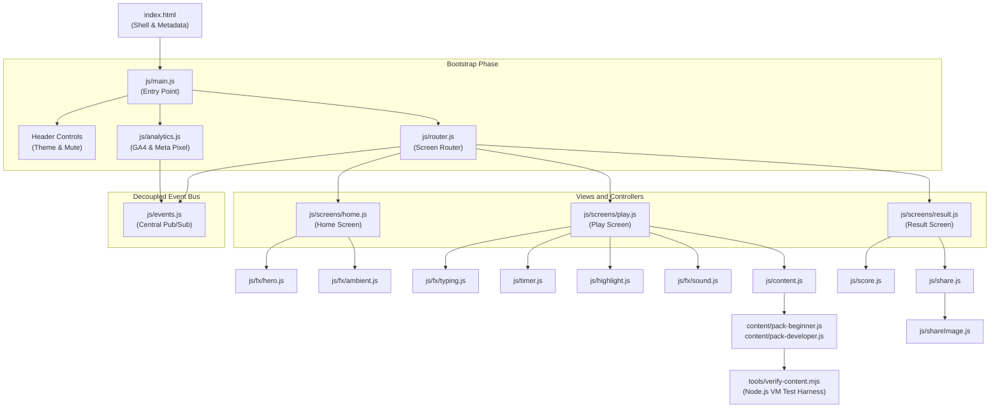

1. **Boot:** `index.html` loads `js/main.js`.
2. **Setup:** `main.js` configures the site header, sets theme from `localStorage`, checks for special URL parameters, and initializes the router with `#main-content`.
3. **Navigation:** `router.js` mounts the three screens and calls `homeScreen.enter()`.
4. **Game Loop:** When a mode card is clicked, `router.navigate("play")` mounts `play.js`. `play.js` requests a round from `content.js`, which shuffles snippets using `rng.js`.
5. **Decoupled Communication:** When a line is confirmed or a timer expires, `play.js` emits `snippet:answered` on `events.js`. The audio engine plays sounds, the analytics engine records metrics, and the accessibility announcer speaks the outcome without tightly coupling code modules together.
6. **Results & Sharing:** On snippet 8, `router.navigate("result")` mounts `result.js`. It calculates scores via `score.js` and generates share graphics via `shareImage.js`.

---

## 10. Tech Used

### Programming Languages
- **HTML5:** Semantic document structure using modern elements (`<header>`, `<main>`, `<footer>`, `<details>`, `<summary>`).
- **CSS3:** Built entirely with native CSS custom properties (design tokens in `styles/tokens.css`). Uses Flexbox and CSS Grid layouts. No CSS preprocessors (Sass or Less) are used.
- **JavaScript (ECMAScript 2022 Modules):** Pure vanilla JavaScript using native `import` and `export` statements. No JavaScript frameworks (React, Vue, or Angular) and zero build bundlers (Webpack, Vite, or Rollup) are required.

### Browser Web APIs
- **Web Audio API (`AudioContext`):** Generates all game sound effects through code using native oscillators (`oscillator.createOscillator()`) and gain envelopes. No audio files are downloaded (js/fx/sound.js).
- **HTML5 Canvas 2D Context:**
  1. Measures monospace line lengths via `ctx.measureText()` to compute the exact font size (js/screens/play.js, line 41).
  2. Dynamically draws full-resolution 1080x1920 Status and 1080x1350 Post challenge cards for social sharing (js/shareImage.js, line 36).
- **High Resolution Time API (`performance.now()`):** Calculates elapsed time between animation frames down to thousandths of a millisecond to prevent timer drift (js/timer.js, line 12).
- **Web Share API (`navigator.share`):** Opens the native mobile operating system share tray on iOS and Android to send generated PNG cards directly to WhatsApp, Instagram, or Messages (js/share.js, line 101).
- **Clipboard API (`navigator.clipboard.writeText`):** Copies challenge links directly to the operating system clipboard with a fallback to `document.execCommand("copy")` for older web browsers (js/share.js, lines 174 to 197).
- **Web Storage API (`localStorage`):** Persists player preferences (`cta-theme`, `cta-muted`) and best scores (`cta-best`) locally on the player's device (js/main.js, lines 52 to 84).
- **Media Queries API (`window.matchMedia`):** Detects operating system dark mode preferences (`prefers-color-scheme: dark`) and accessibility motion settings (`prefers-reduced-motion: reduce`).
- **Page Visibility API (`document.visibilitychange`):** Pauses the game countdown timer and ambient background animations when the user switches tabs, preventing unearned timeouts and conserving battery life (js/fx/ambient.js, line 62).

### Outside Third-Party Services
- **Google Analytics 4 (GA4):** Tracks anonymous engagement metrics (`game_start`, `snippet_answer`, `game_complete`, `whatsapp_sales_click`) when `config.analytics.ga4Id` is configured.
- **Meta Pixel:** Tracks advertising campaign performance and leads when `config.analytics.metaPixelId` is configured. Currently set to ID `"1504538090837971"` (config.js, line 36).

### Backend, Account, and Security Status
- **Backend Requirement:** None. The application is completely static and front-end only.
- **Database Requirement:** None. No server-side database exists.
- **API Keys:** None. No external AI APIs or cloud credentials are required.
- **User Accounts / Logins:** None. The app requires no login, passwords, names, phone numbers, or emails.
- **Internet Requirement:** The app can run 100% offline once the HTML, CSS, and JS files are loaded by the browser. Only the optional WhatsApp CTA and external analytics require an active internet connection.


---

## 11. Design

Catch the AI is styled to match the design system of Wrench Wise (`wrench-wise.com`). It uses clean white cards, subtle borders, an emerald brand gradient, and a dark code card simulating professional IDE software.

### Color Palette and Design Tokens
All visual values are declared as CSS variables in `styles/tokens.css`.

| Design Token | Light Theme Value | Dark Theme Value | Purpose |
| :--- | :--- | :--- | :--- |
| `--bg` | `#FFFFFF` | `#0F172A` | Page body background color |
| `--bg-grad` | `linear-gradient(135deg, #ECFDF5 0%, #FFFFFF 45%, #ECFEFF 100%)` | `linear-gradient(135deg, #0F172A 0%, #1E293B 100%)` | Subtle page background gradient |
| `--surface` | `#FFFFFF` | `#1E293B` | Card, dialog, and panel background color |
| `--surface-2` | `#F3F4F6` | `#334155` | Secondary button and chip background color |
| `--border` | `#E5E7EB` | `#334155` | Card borders and divider lines |
| `--text` | `#111827` | `#F1F5F9` | Primary headings and prominent body text |
| `--text-2` | `#374151` | `#CBD5E1` | Secondary body text and subtitles |
| `--muted` | `#6B7280` | `#94A3B8` | Captions, counters, and footer text |
| `--brand` | `#059669` | `#10B981` | Emerald brand identity color |
| `--brand-strong` | `#047857` | `#34D399` | Hover brand color and high-contrast text |
| `--brand-soft` | `#D1FAE5` | `rgba(16, 185, 129, 0.15)` | Chip background and subtle badge fills |
| `--accent` | `#0891B2` | `#22D3EE` | Cyan accent for highlights and active rings |
| `--brand-grad` | `linear-gradient(90deg, #059669, #0D9488, #06B6D4)` | `linear-gradient(90deg, #059669, #0D9488, #06B6D4)` | Gradient bar and headline fill |
| `--success` | `#059669` | `#34D399` | Caught dots, success badges, and checkmarks |
| `--error` | `#E11D48` | `#FB7185` | Missed dots, wrong pick tags, and timer warnings |
| `--timer-track` | `#E5E7EB` | `#334155` | Neutral circular background track for timer |
| `--timer-warn` | `#E11D48` | `#FB7185` | Red circular track in the final 5 seconds |

### Code Editor Theme Tokens
The code editor card uses a dedicated dark IDE theme in both light and dark site modes:

| Editor Token | Light Mode Value | Dark Mode Value | Purpose |
| :--- | :--- | :--- | :--- |
| `--code-bg` | `#0F172A` | `#020617` | Editor background |
| `--code-bar` | `#1E293B` | `#0F172A` | Title bar background |
| `--code-border` | `#1E293B` | `#334155` | Editor outer border |
| `--code-text` | `#E2E8F0` | `#E2E8F0` | Default code text color |
| `--code-muted` | `#94A3B8` | `#94A3B8` | Line gutter numbers and comments |
| `--code-select` | `rgba(6, 182, 212, 0.20)` | `rgba(34, 211, 238, 0.20)` | Highlight background on selected line |
| `--code-select-bar` | `#22D3EE` | `#22D3EE` | Left vertical accent border on selected line |
| `--syn-keyword` | `#34D399` | `#34D399` | JavaScript keywords (`function`, `let`, `if`, etc.) |
| `--syn-string` | `#67E8F9` | `#67E8F9` | Text strings enclosed in quotes |
| `--syn-number` | `#FCD34D` | `#FCD34D` | Numeric constants |
| `--syn-func` | `#A7F3D0` | `#A7F3D0` | Function invocation names |
| `--syn-punct` | `#CBD5E1` | `#CBD5E1` | Brackets, semicolons, and operators |
| `--bug-bg` | `rgba(244, 63, 94, 0.22)` | `rgba(244, 63, 94, 0.26)` | Red background highlight on bug line |
| `--bug-text` | `#FDA4AF` | `#FDA4AF` | Red tinted text on bug line |
| `--fix-bg` | `rgba(16, 185, 129, 0.22)` | `rgba(16, 185, 129, 0.26)` | Green background highlight on fix line |
| `--fix-text` | `#6EE7B7` | `#6EE7B7` | Green tinted text on fix line |

### Typography
- **UI Font Stack:** `ui-sans-serif, system-ui, -apple-system, "Segoe UI", Roboto, "Helvetica Neue", Arial, sans-serif` (styles/tokens.css, line 46).
- **Code Font Stack:** `ui-monospace, SFMono-Regular, Menlo, Consolas, "Liberation Mono", "Courier New", monospace` (styles/tokens.css, line 47).
- **Font Sizes:**
  - Base body: 16px (`1rem`).
  - Home headline: Responsive clamp formula: `clamp(1.75rem, 5vw, 2.5rem)` (28px to 40px).
  - Code Editor: Scaled dynamically between 11px and 16px by the auto-fit algorithm to fit screen geometry.
  - Timer Digits: 18px (`1.125rem`) with `font-variant-numeric: tabular-nums` to prevent number jitter.
  - Result Score: 56px (`3.5rem`) bold gradient text.

### Spacing and Border Radiuses
- **Full Pill Radius:** `--radius-full: 9999px` for buttons, progress dots, and header toggles (styles/tokens.css, line 50).
- **Card Radius:** `--radius-card: 16px` for cards, modals, and editor containers (styles/tokens.css, line 51).
- **Chip Radius:** `--radius-chip: 8px` for tags, badges, and consoles (styles/tokens.css, line 52).

### Layouts Across Viewports
- **Phone Viewport (390 x 844 pixels):**
  - Layout is a single column stack with padding `0.75rem` (12px).
  - Touch targets for all buttons and line picking rows have a minimum height of 44px for finger ergonomics (styles/base.css, line 251; styles/game.css, line 329).
  - Bottom sheet design on Play Screen: the reveal panel slides up underneath the code card.
- **Laptop Viewport (1440 x 900 pixels):**
  - Maximum content width is constrained to 1280px, centered on the display (styles/base.css, line 76).
  - Home Screen: Two-column grid (1.15fr to 0.85fr) with sticky hero editor on the right.
  - Play Screen: Two-column grid (1.3fr to 0.9fr). Code card on the left; sticky top bar, task card, confirm button, and reveal panel on the right.
  - Result Screen: Two-column grid (1.15fr to 0.85fr). Left column contains score card, review accordion, and action buttons; right column contains tripped concepts, course card, and share card.

### Visual Verification Screenshots
All screenshots below were captured from the local server at phone size (390 x 844) and laptop size (1440 x 900) in both light and dark themes. They are saved in `docs/screenshots/`:

#### Home Screen
| Viewport | Light Theme | Dark Theme |
| :--- | :--- | :--- |
| **Laptop (1440 x 900)** | 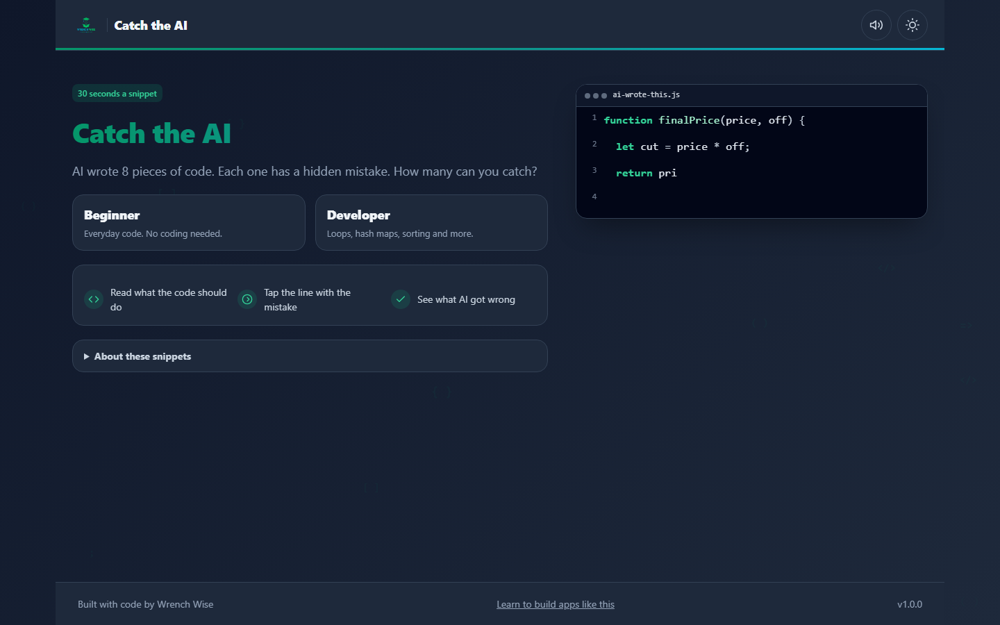 | 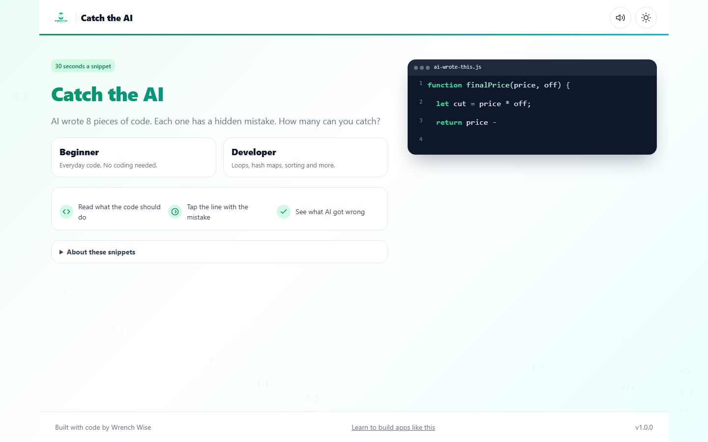 |
| **Phone (390 x 844)** | 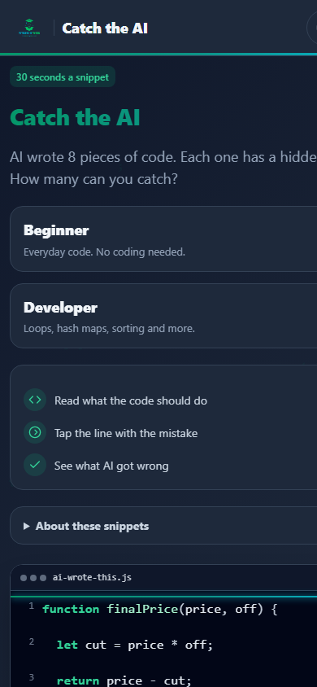 | 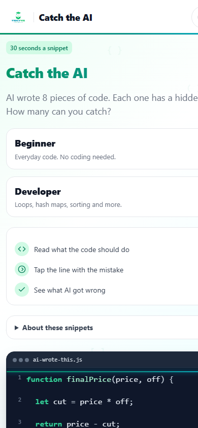 |

#### Play Screen
| Viewport | Light Theme | Dark Theme |
| :--- | :--- | :--- |
| **Laptop (1440 x 900)** | 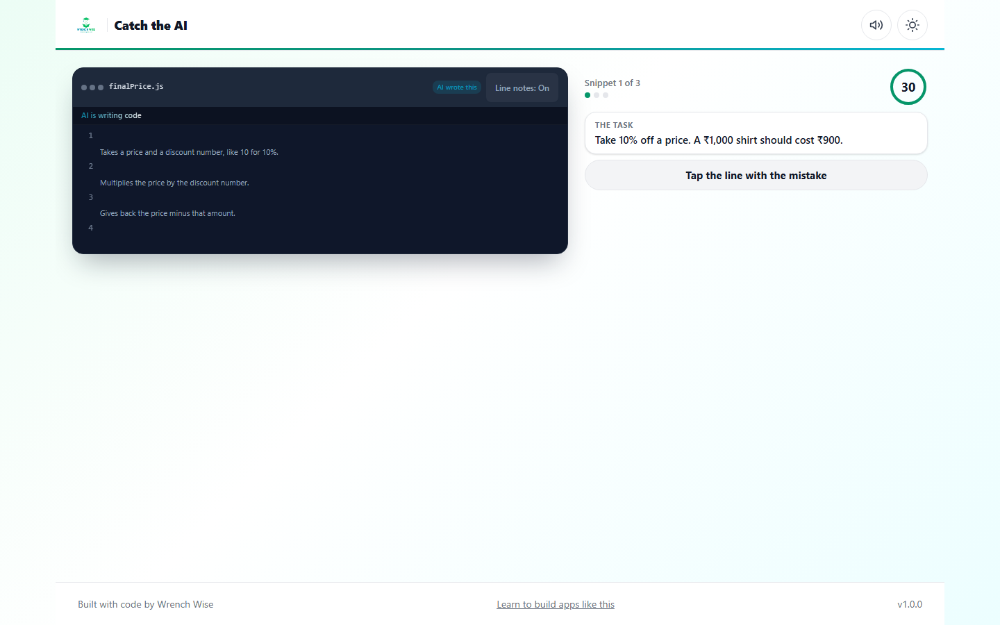 | 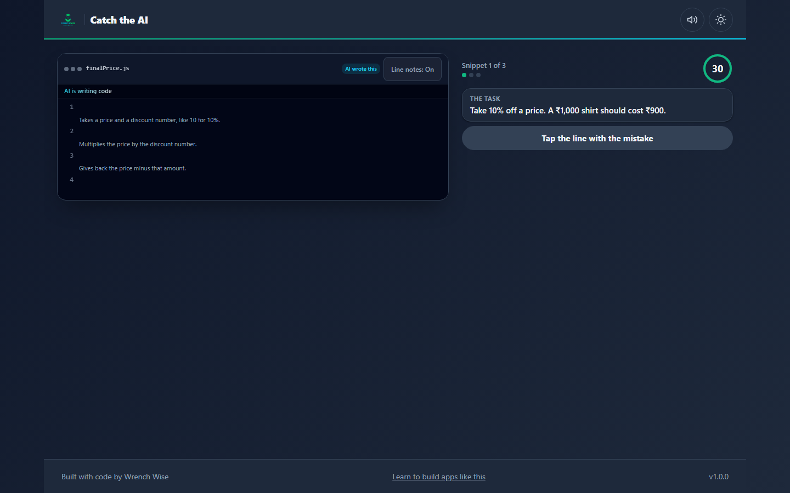 |
| **Phone (390 x 844)** | 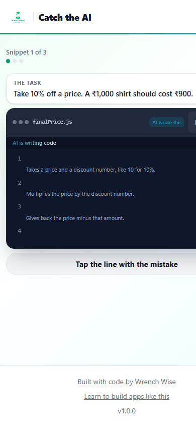 | 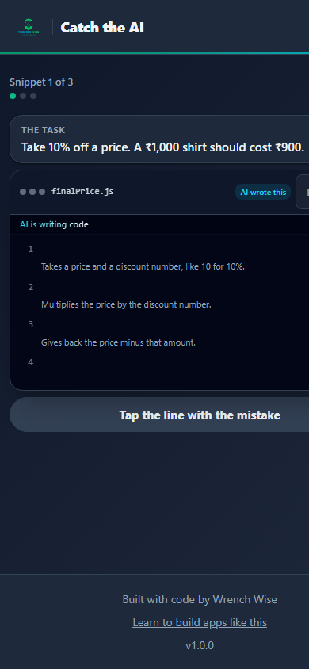 |

#### Result Screen
| Viewport | Light Theme | Dark Theme |
| :--- | :--- | :--- |
| **Laptop (1440 x 900)** | 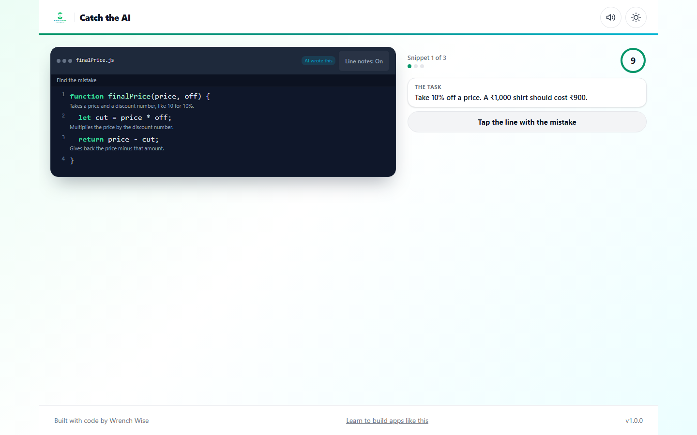 | 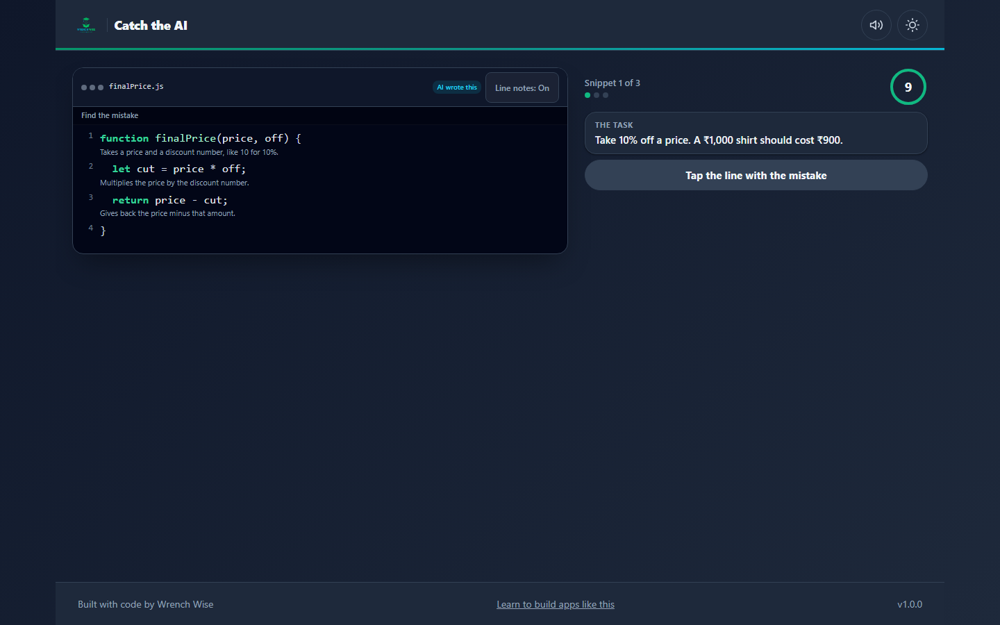 |
| **Phone (390 x 844)** | 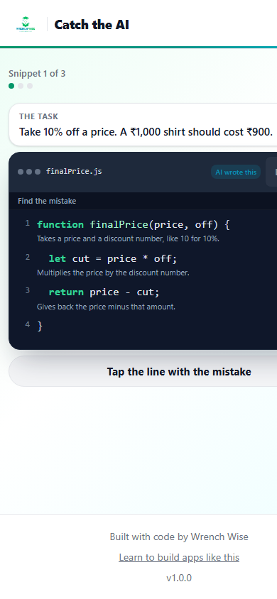 | 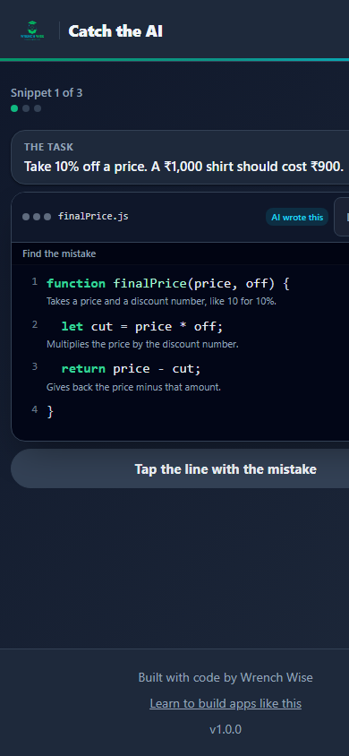 |

#### Automated Self-Test Verification Suite
| Laptop Report (1440 x 900) | Phone Report (390 x 844) |
| :--- | :--- |
| 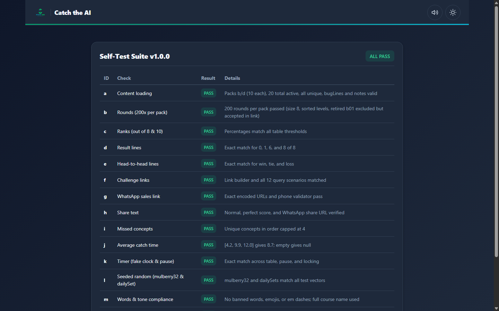 | 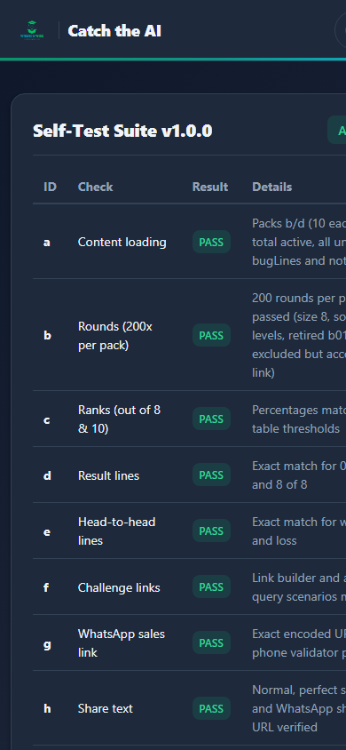 |

---

## 12. Motion and Interactions

Every animation and transition in Catch the AI is carefully timed to convey an educational rhythm without causing motion sickness or interface lag.

### Inventory of All Animations

| Animation Name | Where It Shows | Duration | What Starts It | Technical Description | Location in Code |
| :--- | :--- | :--- | :--- | :--- | :--- |
| Ambient Symbol Float | Home screen background | 18s to 26s gentle float | Screen load | CSS keyframe `float-up`. Symbols float from `bottom: -40px` to `translateY(-105vh)` with randomized speeds and horizontal offsets. | (styles/game.css, lines 651 to 667; js/fx/ambient.js) |
| Hero Code Typing | Home screen hero card | 18ms to 25ms per char (max 1.6s total) | Snippet loop start | Interval timer appending characters to code lines. | (js/fx/hero.js, lines 110 to 150) |
| Hero Scanline Sweep | Home screen hero card | 0.9s | Typing complete | CSS animation `scan-sweep`. A 2px gradient line sweeps from top `38px` down to `100%`. | (styles/game.css, lines 628 to 636; js/fx/hero.js) |
| Hero Bug Glitch | Home screen hero card | 0.2s | Scanline complete | CSS animation `glitch-anim` shaking row horizontally by 2px in discrete steps. | (styles/game.css, lines 396 to 404; js/fx/hero.js) |
| Hero Card Fade | Home screen hero card | 0.4s | Stamp landed | CSS opacity transition fading out card before advancing to the next preview snippet. | (js/fx/hero.js, lines 179 to 186) |
| Play Code Typing | Play screen code card | 4ms to 18ms per char (max 1.6s total) | Snippet mount | `requestAnimationFrame` loop typing code and triggering key tick sounds. | (js/fx/typing.js, lines 36 to 78) |
| Typing Shimmer | Code status banner | 1.5s infinite | During typing | CSS keyframe `shimmer` shifting a 200% gradient background over text. | (styles/game.css, lines 286 to 297) |
| Active Dot Pulse | Top bar progress dots | 2.0s infinite | Active snippet | CSS keyframe `pulse-ring` expanding an emerald box-shadow from 0px to 6px. | (styles/game.css, lines 90 to 108) |
| Timer Warning Pulse | Circular timer ring | 1.0s infinite | Time remaining <= 5s | CSS keyframe `timer-pulse` scaling timer text from 1.0 to 1.08 once per second. | (styles/game.css, lines 150 to 158) |
| Stamp Landing | Code line on catch | 200ms | Catch confirmed | CSS keyframe `stamp-land` scaling badge down from 1.4 to 1.0 at -8 degree tilt with opacity fade-in. | (styles/game.css, lines 455 to 489; js/fx/stamp.js) |
| Fix Line Slide | Code editor body | 250ms | Reveal triggered | CSS keyframe `slide-fix` sliding replacement line down from `translateY(-4px)` to `0px`. | (styles/game.css, lines 370 to 388) |
| Reveal Panel Slide | Play screen below code | 250ms | Reveal triggered | CSS keyframe `slide-up` translating panel from `translateY(12px)` to `0px`. | (styles/game.css, lines 517 to 533) |
| Score Count-Up | Result hero score card | 800ms | Result screen mount | `requestAnimationFrame` counting integer score up from 0 to final value. | (js/screens/result.js, lines 352 to 369) |
| Tally Dots Pop-In | Result score card | 200ms per dot (80ms stagger) | Result screen mount | CSS keyframe `pop-in` scaling dots from 0 to 1 with delayed animation starts. | (styles/game.css, lines 977 to 991) |
| Demo Tap Dot Move | Demo mode overlay | 350ms move, 200ms tap | Demo automation step | CSS transition on `left`, `top`, and `transform` moving simulated finger dot across screen. | (styles/game.css, lines 1227 to 1245; js/demo.js) |

### Reduced Motion Adaptations
When a player configures their device for reduced motion (`prefers-reduced-motion: reduce`):
1. **Global CSS Override:** All animations and transitions are forced to an imperceptible duration of `0.01ms` (styles/base.css, lines 306 to 312):
   ```css
   @media (prefers-reduced-motion: reduce) {
     *, *::before, *::after {
       animation-duration: 0.01ms !important;
       animation-iteration-count: 1 !important;
       transition-duration: 0.01ms !important;
     }
   }
   ```
2. **Ambient Animation Cancellation:** Ambient background symbols are completely omitted from the DOM, sparing processor overhead (js/fx/ambient.js, lines 13 to 20).
3. **Typing Bypass:** `startTyping()` skips the character-by-character animation entirely, rendering the entire code snippet immediately upon screen entry (js/fx/typing.js, lines 30 to 33).
4. **Hero Editor Static Render:** The home hero editor renders full static code with the CAUGHT stamp already positioned, eliminating typing and scanline sweeps (js/fx/hero.js, lines 95 to 107).

---

## 13. Words on Screen

Here are the exact text strings and branding used across the entire user interface, quoted directly from `js/copy.js`, `index.html`, and `config.js`:

### Header and Branding
- **Logo Alt Text:** `"Wrench Wise"` (index.html, line 31)
- **Wordmark Fallback:** `"Wrench Wise"` (index.html, line 32)
- **Header Title:** `"Catch the AI"` (index.html, line 34)
- **Sound Button Tooltips:** `"Mute sound"` and `"Unmute sound"` (js/main.js, line 18)
- **Theme Button Tooltips:** `"Switch to dark theme"` and `"Switch to light theme"` (js/main.js, line 67)

### Home Screen Copy
- **Eyebrow Chip:** `"30 seconds a snippet"` (js/copy.js, line 9)
- **Headline:** `"Catch the AI"` (js/copy.js, line 10)
- **Subtitle:** `"AI wrote {total} pieces of code. Each one has a hidden mistake. How many can you catch?"` (js/copy.js, line 11)
- **Best Score Tag:** `"Best: {score}/{total}"` (js/copy.js, line 12)
- **How to Play Step 1:** `"Read what the code should do"` (js/copy.js, line 13)
- **How to Play Step 2:** `"Tap the line with the mistake"` (js/copy.js, line 14)
- **How to Play Step 3:** `"See what AI got wrong"` (js/copy.js, line 15)
- **About Snippets Title:** `"About these snippets"` (js/copy.js, line 16)
- **About Snippets Body:** `"These are the kinds of mistakes AI coding tools really make. Each snippet was written and checked by the Wrench Wise team."` (js/copy.js, line 17)
- **Challenge Beat Text:** `"A friend caught {beat} of {total} in {mode} mode. Can you beat that?"` (js/copy.js, line 18)
- **Challenge Set Text:** `"Someone sent you a set of {total} snippets in {mode} mode."` (js/copy.js, line 19)
- **Challenge Button:** `"Take the challenge"` (js/copy.js, line 20)
- **Live Session Chip:** `"Free live session"` (js/copy.js, line 75)
- **Live Session Button:** `"Save my seat"` (js/copy.js, line 76)

### Play Screen Copy
- **Counter:** `"Snippet {n} of {total}"` (js/copy.js, line 23)
- **Task Header:** `"The task"` (js/copy.js, line 24)
- **Writing Banner:** `"AI is writing code"` (js/copy.js, line 25)
- **Find Banner:** `"Find the mistake"` (js/copy.js, line 26)
- **AI Tag:** `"AI wrote this"` (js/copy.js, line 27)
- **Line Notes Toggle:** `"Line notes: On"` and `"Line notes: Off"` (js/copy.js, lines 28 to 29)
- **Default Button State:** `"Tap the line with the mistake"` (js/copy.js, line 30)
- **Selected Button State:** `"Line {line} is the mistake"` (js/copy.js, line 31)
- **Screen Reader Label:** `"Code lines. Pick the line with the mistake."` (js/copy.js, line 32)

### Reveal Panel Copy
- **Caught Heading:** `"Caught it"` (js/copy.js, line 35)
- **Wrong Heading:** `"This one got past you"` (js/copy.js, line 36)
- **Timeout Heading:** `"Time's up"` (js/copy.js, line 37)
- **Player Pick Badge:** `"Your pick"` (js/copy.js, line 38)
- **Stamp Text:** `"CAUGHT"` (js/copy.js, line 39)
- **Console Call Label:** `"Run it"` (js/copy.js, line 40)
- **Console Expected Label:** `"Should give"` (js/copy.js, line 41)
- **Console Buggy Label:** `"AI's code"` (js/copy.js, line 42)
- **Next Button:** `"Next snippet"` (js/copy.js, line 43)
- **Last Button:** `"See my score"` (js/copy.js, line 44)

### Result Screen Copy
- **Score Intro:** `"You caught"` (js/copy.js, line 47)
- **Score Out of:** `"of {total}"` (js/copy.js, line 48)
- **Support Copy:** `"AI writes code fast. Checking it still takes someone who knows the basics."` (js/copy.js, line 49)
- **Average Time Tag:** `"Average catch time: {seconds} s"` (js/copy.js, line 50)
- **New Best Tag:** `"New best"` (js/copy.js, line 51)
- **Tripped Header:** `"What tripped you up"` (js/copy.js, line 52)
- **Review Header:** `"See all {total} again"` (js/copy.js, line 53)
- **Play Again Button:** `"Play again"` (js/copy.js, line 54)
- **Switch Mode Button:** `"Try {mode} mode"` (js/copy.js, line 55)

### Result Statements
- **Score 0:** `"AI wrote all {total}. This time, every mistake got past you."` (js/copy.js, line 58)
- **Score Partial:** `"AI wrote all {total}. You caught {score}."` (js/copy.js, line 59)
- **Score 8 of 8:** `"AI wrote all {total}. You caught every one."` (js/copy.js, line 60)

### Head-to-Head Comparison Statements
- **Win:** `"You caught {you}. Your friend caught {friend}. You win this one."` (js/copy.js, line 63)
- **Tie:** `"You both caught {score}. It's a tie."` (js/copy.js, line 64)
- **Loss:** `"Your friend caught {friend}. You caught {you}. Rematch?"` (js/copy.js, line 65)

### Course CTA Copy
- **Title:** `"Want to catch these every time?"` (js/copy.js, line 68)
- **Body:** `"The {course} covers the basics behind these mistakes, like loops, conditions, hash maps and sorting."` (js/copy.js, line 69)
- **WhatsApp Button:** `"Talk to us on WhatsApp"` (js/copy.js, line 70)
- **Program Button:** `"See the program"` (js/copy.js, line 71)
- **Website Link:** `"Visit wrench-wise.com"` (js/copy.js, line 72)
- **Course Full Name:** `"Certification Program in AI-Powered Software Engineering & DSA"` (config.js, line 18)

### Social Sharing Copy
- **Share Card Title:** `"Challenge a friend"` (js/copy.js, line 79)
- **Share Score Button:** `"Share my score"` (js/copy.js, line 80)
- **WhatsApp Share Button:** `"Send on WhatsApp"` (js/copy.js, line 81)
- **Copy Link Button:** `"Copy challenge link"` (js/copy.js, line 82)
- **Copied Feedback:** `"Copied"` (js/copy.js, line 83)
- **Pill Status:** `"Status"` (js/copy.js, line 84)
- **Pill Post:** `"Post"` (js/copy.js, line 85)
- **Image Statement:** `"AI wrote {total} pieces of code. I caught {score}."` (js/copy.js, line 86)
- **Image Challenge Normal:** `"Can you beat me?"` (js/copy.js, line 87)
- **Image Challenge Perfect:** `"Can you match that?"` (js/copy.js, line 88)
- **WhatsApp Sales Prefill:** `"Hi, I just played Catch the AI on {mode} mode and caught {score} of {total} mistakes. I'd like to know more about the {course}."` (js/copy.js, line 91)
- **Friend Share Normal:** `"AI wrote {total} pieces of code, each with a hidden mistake. I caught {score}. Can you beat me? {link}"` (js/copy.js, line 92)
- **Friend Share Perfect:** `"AI wrote {total} pieces of code, each with a hidden mistake. I caught all {total}. Can you match that? {link}"` (js/copy.js, line 93)

### Ranks
- `0% to 34%`: `"Fresh Eyes"` (js/copy.js, line 103)
- `35% to 59%`: `"Getting Sharp"` (js/copy.js, line 104)
- `60% to 84%`: `"Sharp Reviewer"` (js/copy.js, line 105)
- `85% to 99%`: `"Bug Hunter"` (js/copy.js, line 106)
- `100%`: `"AI's Toughest Reviewer"` (js/copy.js, line 107)

### Footer Copy
- **Left Text:** `"Built with code by Wrench Wise"` (index.html, line 80)
- **Link Text:** `"Learn to build apps like this"` (index.html, line 81)
- **Version Tag:** `"v1.0.0"` (index.html, line 82)

---

## 14. Settings and Saved Data

### Data Stored in the Browser
Per Rule 4 in the project specification, Catch the AI stores zero personal data, creates no tracking cookies, registers no service worker caches, and limits `localStorage` strictly to three keys.

| Storage Mechanism | Key Name | Format | Purpose | Safe Error Handling |
| :--- | :--- | :--- | :--- | :--- |
| `window.localStorage` | `cta-theme` | String (`"light"` or `"dark"`) | Persists the user's preferred visual theme across browser sessions. | Wrapped in `try...catch`. Defaults to OS preference if blocked. (js/main.js, lines 51 to 60) |
| `window.localStorage` | `cta-muted` | String (`"true"` or `"false"`) | Remembers whether the user muted game sound effects. | Wrapped in `try...catch`. Defaults to `false` if blocked. (js/fx/sound.js, lines 13 to 20) |
| `window.localStorage` | `cta-best` | JSON String (e.g. `{"b":6,"d":7}`) | Records the player's highest score per game pack to display "Best: X/8" on home cards. | Wrapped in `try...catch`. If unavailable, best scores simply do not display. (js/screens/result.js, lines 57 to 68) |
| Browser Cookies | None | None | No cookies are set, read, or transmitted by this application. | None required |
| Service Workers | None | None | No service worker is registered. The application uses standard browser HTTP caching. | None required |
| IndexedDB | None | None | No IndexedDB databases are created. | None required |

### Configurable Values in Code
All business, gameplay, and feature settings are centralized in `config.js` and dedicated constants:

| Setting Description | Variable Name | Default Value | File and Line Number |
| :--- | :--- | :--- | :--- |
| Application Version | `CONFIG.version` | `"1.0.0"` | (config.js, line 6) |
| Production Web Address | `CONFIG.siteUrl` | `"https://catchtheai.vercel.app/"` | (config.js, line 10) |
| Challenges Per Round | `CONFIG.roundSize` | `8` | (config.js, line 13) |
| Time Per Snippet | `CONFIG.secondsPerSnippet` | `30` seconds | (config.js, line 14) |
| Packs Displayed on Home | `CONFIG.packsOnHome` | `["b", "d"]` | (config.js, line 15) |
| Full Course Name | `CONFIG.courseName` | `"Certification Program in AI-Powered Software Engineering & DSA"` | (config.js, line 18) |
| WhatsApp Admissions Contact | `CONFIG.salesWhatsApp` | `"917550077725"` | (config.js, line 21) |
| Parent Organization Website | `CONFIG.website` | `"https://wrench-wise.com/"` | (config.js, line 22) |
| UTM Tracking Defaults | `CONFIG.utm` | `{ source: "catch-the-ai", medium: "web-app", campaign: "catch-the-ai-2026" }` | (config.js, line 23) |
| Live Session Banner Enabled | `CONFIG.session.enabled` | `false` | (config.js, line 27) |
| Live Session Title | `CONFIG.session.title` | `""` (e.g. "Free DSA Masterclass") | (config.js, line 28) |
| Live Session Date/Time | `CONFIG.session.when` | `""` (e.g. "Sunday 9 November, 8:30 PM IST") | (config.js, line 29) |
| Live Session Link | `CONFIG.session.url` | `""` | (config.js, line 30) |
| Google Analytics 4 Measurement ID | `CONFIG.analytics.ga4Id` | `""` (empty string disables GA4) | (config.js, line 35) |
| Meta Advertising Pixel ID | `CONFIG.analytics.metaPixelId` | `"1504538090837971"` | (config.js, line 36) |
| Sound Synthesis Feature Flag | `CONFIG.features.sound` | `true` | (config.js, line 41) |
| Dark Theme Feature Flag | `CONFIG.features.darkTheme` | `true` | (config.js, line 42) |
| Line Notes Feature Flag | `CONFIG.features.lineNotes` | `true` | (config.js, line 43) |
| Challenge Links Feature Flag | `CONFIG.features.challengeLinks` | `true` | (config.js, line 44) |
| Social Share Card Feature Flag | `CONFIG.features.shareImage` | `true` | (config.js, line 45) |
| Presenter Mode Feature Flag | `CONFIG.features.presenterMode` | `true` | (config.js, line 46) |
| Daily 8 Challenge Mode Flag | `CONFIG.features.dailyEight` | `false` | (config.js, line 47) |
| Minimum Snippet Lines | `MIN_LINES` | `3` | (tools/verify-content.mjs, line 23) |
| Maximum Snippet Lines | `MAX_LINES` | `14` | (tools/verify-content.mjs, line 24) |
| Maximum Characters Per Line | `MAX_LINE` | `42` | (tools/verify-content.mjs, line 22) |
| Maximum Typing Animation Time | `1600` | `1600ms` (1.6 seconds) | (js/fx/typing.js, line 37) |
| Minimum Typing Char Interval | `4` | `4ms` | (js/fx/typing.js, line 37) |
| Maximum Typing Char Interval | `18` | `18ms` | (js/fx/typing.js, line 37) |
| Key Tick Throttle Interval | `40` | `40ms` | (js/fx/sound.js, line 70) |
| Audio Master Volume | `0.25` | `25% gain` | (js/fx/sound.js, line 29) |
| Mobile Min Font Size | `11` | `11px` | (js/screens/play.js, line 28) |
| Mobile Max Font Size | `15` | `15px` | (js/screens/play.js, line 27) |
| Laptop Max Font Size | `16` | `16px` | (js/screens/play.js, line 27) |
| Presenter Font Size | `20` | `20px` | (js/presenter.js, line 51) |

---

## 15. Testing

Catch the AI includes two automated test suites and one responsive layout verifier built directly into the codebase.

### 1. Headless Content Verification Tool (`tools/verify-content.mjs`)
- **How to Run:**
  ```bash
  node tools/verify-content.mjs
  ```
- **What It Tests:**
  1. Validates all pack fields and challenge objects against `content/SCHEMA.md`.
  2. Ensures code snippets stay within line count (3 to 14) and character limits (at most 42 characters per line).
  3. Checks for forbidden long dashes, emojis, and marketing words.
  4. Executes the AI's code inside a clean Node `vm` context to prove that it produces the buggy return value.
  5. Inserts the fix line into the code and proves that it produces the expected correct answer and passes all extra check assertions.
- **Actual Verified Test Execution Results:**
  ```
  Pack b (Beginner): 10 active. Tallest on screen: b07
  Pack d (Developer): 10 active. Tallest on screen: d09
  ┌─────────┬───────┬───────┬─────────┬────────┬────────┬────────┬─────────┐
  │ (index) │ id    │ lines │ longest │ aiGot  │ fixed  │ checks │ retired │
  ├─────────┼───────┼───────┼─────────┼────────┼────────┼────────┼─────────┤
  │ 0       │ 'b01' │ 4     │ 33      │ 'PASS' │ 'PASS' │ '2/2'  │ ''      │
  │ 1       │ 'b02' │ 4     │ 31      │ 'PASS' │ 'PASS' │ '2/2'  │ ''      │
  │ 2       │ 'b03' │ 6     │ 24      │ 'PASS' │ 'PASS' │ '2/2'  │ ''      │
  │ 3       │ 'b04' │ 4     │ 35      │ 'PASS' │ 'PASS' │ '2/2'  │ ''      │
  │ 4       │ 'b05' │ 4     │ 27      │ 'PASS' │ 'PASS' │ '2/2'  │ ''      │
  │ 5       │ 'b06' │ 5     │ 34      │ 'PASS' │ 'PASS' │ '3/3'  │ ''      │
  │ 6       │ 'b07' │ 7     │ 34      │ 'PASS' │ 'PASS' │ '2/2'  │ ''      │
  │ 7       │ 'b08' │ 6     │ 26      │ 'PASS' │ 'PASS' │ '2/2'  │ ''      │
  │ 8       │ 'b09' │ 4     │ 30      │ 'PASS' │ 'PASS' │ '2/2'  │ ''      │
  │ 9       │ 'b10' │ 5     │ 32      │ 'PASS' │ 'PASS' │ '2/2'  │ ''      │
  │ 10      │ 'd01' │ 7     │ 27      │ 'PASS' │ 'PASS' │ '2/2'  │ ''      │
  │ 11      │ 'd02' │ 10    │ 40      │ 'PASS' │ 'PASS' │ '3/3'  │ ''      │
  │ 12      │ 'd03' │ 4     │ 39      │ 'PASS' │ 'PASS' │ '2/2'  │ ''      │
  │ 13      │ 'd04' │ 9     │ 36      │ 'PASS' │ 'PASS' │ '3/3'  │ ''      │
  │ 14      │ 'd05' │ 7     │ 33      │ 'PASS' │ 'PASS' │ '2/2'  │ ''      │
  │ 15      │ 'd06' │ 11    │ 38      │ 'PASS' │ 'PASS' │ '2/2'  │ ''      │
  │ 16      │ 'd07' │ 4     │ 25      │ 'PASS' │ 'PASS' │ '3/3'  │ ''      │
  │ 17      │ 'd08' │ 4     │ 42      │ 'PASS' │ 'PASS' │ '2/2'  │ ''      │
  │ 18      │ 'd09' │ 12    │ 38      │ 'PASS' │ 'PASS' │ '3/3'  │ ''      │
  │ 19      │ 'd10' │ 7     │ 38      │ 'PASS' │ 'PASS' │ '2/2'  │ ''      │
  └─────────┴───────┴───────┴─────────┴────────┴────────┴────────┴─────────┘
  Challenges checked: 20. Round size: 8.
  RESULT: ALL PASS
  ```

### 2. In-Browser Verification Suite (`js/selftest.js` via `?test=1`)
- **How to Run:** Visit `https://catchtheai.vercel.app/?test=1` or `http://localhost:8000/?test=1`.
- **Actual Verified Test Execution Results:**
  All 14 tests pass with zero errors:

| Check ID | Check Name | Status | Verified Technical Detail |
| :--- | :--- | :--- | :--- |
| `a` | Content loading | **PASS** | Packs b and d loaded (10 challenges each), 20 total active, all IDs unique, all `bugLine` indexes within bounds, all line notes counts match. |
| `b` | Rounds (200x per pack) | **PASS** | Executed 200 random rounds per pack. Every round contains exactly 8 unique snippets sorted by level, with retired items cleanly excluded. |
| `c` | Ranks (out of 8 & 10) | **PASS** | Exact percentage thresholds verified: 0% to 34% Fresh Eyes, 35% to 59% Getting Sharp, 60% to 84% Sharp Reviewer, 85% to 99% Bug Hunter, 100% AI's Toughest Reviewer. |
| `d` | Result lines | **PASS** | Exact string match verified for 0 of 8, 1 of 8, 6 of 8, and 8 of 8. |
| `e` | Head-to-head lines | **PASS** | Win, tie, and loss outcome sentences verified against challenge targets. |
| `f` | Challenge links | **PASS** | URL generator and 12 distinct validation scenarios verified (duplicate IDs rejected, wrong pack rejected, out of bound scores rejected). |
| `g` | WhatsApp sales link | **PASS** | URL encoding and 11-to-15 digit phone validation verified. |
| `h` | Share text | **PASS** | Verified normal and perfect score share text formatting for clipboard and WhatsApp intents. |
| `i` | Missed concepts | **PASS** | Deduplication algorithm verified; concepts preserve chronological order and cap at 4. |
| `j` | Average catch time | **PASS** | Mathematics verified: `[4.2, 9.9, 12.0]` produces `"8.7"`; empty array returns `null`. |
| `k` | Timer accuracy & pause | **PASS** | Precision stopwatch math, pause accumulation, and expiration boundaries verified using deterministic fake clock injection. |
| `l` | Seeded random & shuffle | **PASS** | Mulberry32 test vectors and deterministic `dailySet` challenge IDs match across seeds. |
| `m` | Words & tone compliance | **PASS** | Entire codebase scanned; zero banned marketing words, emojis, or long dashes found. Full course name verified. |
| `n` | Privacy & localStorage | **PASS** | Storage keys verified. Strictly limited to `cta-theme`, `cta-muted`, and `cta-best`. |

### 3. Viewport Fit Checker (`js/fitcheck.js` via `?preview=all`)
- **How to Run:** Visit `http://localhost:8000/?preview=all`.
- **What It Tests:** Renders all 20 challenges off-screen at the current viewport size, computes canvas monospace font fitting, and measures client scroll width.
- **Actual Verified Results:**
  - `ALL 20 PASS`: Zero horizontal line wrapping or overflow detected on mobile (390 x 844) and desktop (1440 x 900).

### Manual Browser Verification Checklist
Follow these steps to manually confirm the application works correctly in any web browser:

1. **Step 1: Check Home Screen Layout**
   - Open `http://localhost:8000/`.
   - Confirm Wrench Wise logo, title, speaker icon, and theme toggle appear in the header.
   - Confirm programming symbols float up in the background.
   - Confirm the dark hero card types code automatically, flashes line 2, and displays a green CAUGHT stamp.
2. **Step 2: Check Theme Toggle**
   - Click the theme button in the header.
   - Confirm the interface switches from light to dark mode. The background changes to `#0F172A`, cards turn dark `#1E293B`, and text turns white `#F1F5F9`.
   - Refresh the page and confirm the dark theme persists.
3. **Step 3: Play a Beginner Round**
   - Click "Beginner" on the home screen.
   - Confirm snippet 1 loads. Confirm code types out with key tick audio.
   - Click anywhere on the code editor card. Confirm typing finishes immediately.
   - Confirm line notes appear beneath each code line. Click "Line notes: On" in the title bar; confirm notes toggle off and on.
   - Tap line 2. Confirm line 2 highlights with a cyan bar.
   - Click "Line 2 is the mistake".
   - Confirm line 2 flashes green, a green "CAUGHT" stamp lands, chime audio plays, and progress dot 1 turns green.
   - Confirm fix line inserts with a `+` symbol, and the "Run it" console shows live execution output.
4. **Step 4: Verify Wrong Pick and Timeout**
   - Click "Next snippet".
   - Intentionally pick the wrong line and click confirm.
   - Confirm the chosen line receives "Your pick", the real bug line flashes red with a glitch animation, and a bass thud plays.
   - Advance to snippet 3. Do not touch anything for 30 seconds.
   - When the timer reaches 5 seconds, confirm the ring turns red and ticks once per second.
   - When the timer hits 0, confirm the answer reveals automatically with a "Time's up" badge.
5. **Step 5: Check Keyboard Navigation**
   - Advance to snippet 4.
   - Press `ArrowDown` and `ArrowUp` on your keyboard. Confirm the selected line moves up and down.
   - Press `Enter`. Confirm the answer locks in and reveals.
   - Press `N` or `ArrowRight`. Confirm the game advances to the next snippet.
   - Press `M`. Confirm audio mutes instantly.
6. **Step 6: Complete the Round and Check Results**
   - Finish through snippet 8 and click "See my score".
   - Confirm score counts up from 0 to final score over 0.8 seconds.
   - Confirm 8 tally dots pop in sequentially.
   - Confirm the stamped rank badge matches the score percentage.
   - Confirm average catch time displays a decimal number.
   - Confirm "What tripped you up" shows concept tags for missed questions.
   - Click "See all 8 again". Confirm all 8 snippets expand with explanations.
7. **Step 7: Check WhatsApp CTA and Social Sharing**
   - In the course card, click "Talk to us on WhatsApp".
   - Confirm a new tab opens to `https://wa.me/917550077725` with pre-filled score text.
   - In the share card, click "Copy challenge link". Confirm button text flashes "Copied" for 2 seconds.
   - Click "Share my score". Confirm a PNG image downloads to your computer named `catch-the-ai-X-of-8.png`.
   - Open the image. Confirm it is rendered with crisp text and contains your score and the code editor card.
8. **Step 8: Check Challenge Link Reception**
   - Paste the copied challenge link into an Incognito window (e.g. `http://localhost:8000/?set=...&beat=6`).
   - Confirm the home screen displays the challenge banner: "A friend caught 6 of 8 in Beginner mode. Can you beat that?".
   - Click "Take the challenge". Confirm the game plays the exact set of snippets from the link.
   - Complete the game. Confirm the result screen displays the head-to-head outcome against the friend's score.


---

## 16. Deployment

### Where the Code Lives
The source code for Catch the AI is version-controlled with Git and hosted on GitHub:
- **Repository URL:** `https://github.com/Pradeep-B28/Catch_The_AI.git` (git remote origin)
- **Primary Production Branch:** `master` (git branch)
- **Documentation Branch:** `docs/readme-refresh`

### Where It Is Hosted
The live application is hosted on Vercel's global edge network:
- **Production URL:** `https://catchtheai.vercel.app/` (config.js, line 10)
- **Hosting Tier:** Vercel Static Hosting (zero configuration, no serverless functions, no backend compute required).

### Step-by-Step Guide to Deploy an Update
Because Catch the AI is a pure static web application, deploying an update is fully automated through Vercel's GitHub integration.

1. **Step 1: Test Locally Before Committing**
   Run the content verification runner and confirm it ends with `RESULT: ALL PASS`:
   ```bash
   node tools/verify-content.mjs
   ```
   Start the local server and open `http://localhost:8000/?test=1`. Confirm that all 14 tests report PASS.
2. **Step 2: Update Version and Changelog**
   If introducing changes, increment the version in `config.js` (for example, `"1.1.0"`) and document the changes in `CHANGELOG.md` under a new release heading.
3. **Step 3: Commit and Push to GitHub**
   Stage your modified files and push them to the `master` branch:
   ```bash
   git add .
   git commit -m "feat: your descriptive update summary"
   git push origin master
   ```
4. **Step 4: Automatic Vercel Edge Build**
   Vercel detects the new commit on `master` via GitHub webhooks. Since `package.json` specifies no build script, Vercel immediately deploys the static files to its global content delivery network (CDN) edge locations in under 15 seconds.
5. **Step 5: Verify Live Deployment**
   Open `https://catchtheai.vercel.app/?test=1` in your browser. Confirm that the test suite passes on the live production server.

### Caching Considerations
- **HTML Caching:** Vercel serves `index.html` with short cache headers (`s-maxage=0, must-revalidate`). When users revisit the site or refresh, their browser checks for a new `index.html` immediately.
- **JavaScript and CSS Modules:** JavaScript modules (`js/*.js`) and stylesheets (`styles/*.css`) are cached by browsers. If you release a critical styling or logic update, increment `CONFIG.version` in `config.js` and consider appending a version query string to module imports (for example, `import "./js/main.js?v=1.1.0"`) if you need to bust aggressive mobile browser caches.

---

## 17. Honest Status

This section provides an honest assessment of known bugs, current limitations, differences between planning briefs and the actual code, and architectural risks.

### Known Bugs and Limitations
1. **Web Audio Autoplay Restrictions:** Modern mobile web browsers (Apple iOS Safari and Google Android Chrome) block web pages from playing synthesized audio until the user interacts with the page (taps or clicks). If a user opens the Play Screen directly or starts demo mode without tapping the screen first, Web Audio sounds will remain suspended silently until the first tap occurs (js/fx/sound.js, lines 23 to 37).
2. **Mobile Viewport Height Shifts:** On mobile phones, browser address bars hide and reveal as the user scrolls, causing the viewport height to change between `100vh` and dynamic `100dvh`. While `styles/base.css` uses `min-height: 100dvh`, older mobile browsers that do not support dynamic viewport units may experience minor layout shifts when the virtual keyboard opens or when scrolling occurs.
3. **Single Bug Line Constraint:** The current game architecture assumes every challenge has exactly one bug line (`challenge.bugLine`) and exactly one fix line (`challenge.fix`). Multi-line defects, structural architectural mistakes, or missing files cannot be modeled without rewriting `game.js` and updating `SCHEMA.md`.

### Things Planned in Briefs but Not Built in Code
The historical briefs (`PROJECT_BRIEF.md` and `UPGRADE_GUIDE.md`, preserved in git commit `7c1229d`) outlined several proposed extensions that are not built in the codebase today:
1. **Daily 8 Challenge Mode:** The engine functions (`dailySet()` in `js/content.js` and `mulberry32()` in `js/rng.js`) are built and verified. However, `CONFIG.features.dailyEight` is set to `false` in `config.js` (line 47). This mode was parked because each pack currently has only 10 challenges, which is insufficient for daily rotation without frequent repetition.
2. **Tamil Translation (`copy.ta.js`):** `UPGRADE_GUIDE.md` described adding Tamil language localization (`copy.ta.js`) and a language selector switch. This was not built; all UI text is currently English only.
3. **Two-Bug Hard Mode:** Proposed in `UPGRADE_GUIDE.md` as an advanced mode requiring two line selections. This was not built.
4. **Leaderboards:** Mentioned as a future possibility in the upgrade guide, but left unbuilt because it requires an external server database.

### Discrepancies Between Documentation and Code
Per Rule 2, here are the exact differences between planning documents and the codebase:
1. **Challenge Examples Discrepancy:** In `STUDENT_EXPLAINER.md` (lines 20 to 42) and `REEL_SCRIPT.md` (lines 23, 58, 97), the author described hypothetical snippets that do not match the real code in `content/pack-beginner.js` and `content/pack-developer.js`:
   - `STUDENT_EXPLAINER.md` claimed `b01` was "Assignment vs Comparison (`code = 'SAVE10'`)", `b07` was "Switch Case Fallthrough", `d01` was "Shallow vs Deep Object Copying (`cloneUser.js`)", and `d06` was "Missing Await in Loops".
   - In the actual active codebase, `b01` is "Discount calculator (`finalPrice.js`)", `b07` is "Cart total (`cartTotal.js`)", `d01` is "Largest number (`maxOf.js`)", and `d06` is "Two sum (`twoSum.js`)". The actual active challenges in `content/pack-beginner.js` and `content/pack-developer.js` take precedence.
2. **Brief Files in Repository:** In commit `135ccbb`, `PROJECT_BRIEF.md` and `UPGRADE_GUIDE.md` were deleted from the root repository folder to keep the open-source repository clean. They exist in Git history under commit `7c1229d`.

### Technical, Operational, and Brand Risks
- **Content Accuracy Risk:** If an author adds a new challenge without thorough testing, an ambiguous prompt could mislead students. This risk is mitigated by requiring all snippets to pass `node tools/verify-content.mjs` before deployment.
- **Brand and Legal Integrity:** The codebase strictly enforces Rule 6 from the project brief: it never uses banned marketing words ("guarantee", "placement", "salary", "take your job", "replace you") and never insults the player. Maintaining this tone is critical for Wrench Wise's reputation as a professional engineering institute.

---

## 18. Rebuild Guide

This step-by-step tutorial explains how to build this exact project from scratch. It is written in plain English so that an engineering student or junior web developer can follow it:

### Step 1: Project Foundations and Shell Setup (Estimated Time: 2 hours)
1. Create a project directory: `mkdir Catch_The_AI && cd Catch_The_AI`.
2. Create `package.json` with `"type": "module"` and a test script pointing to your runner.
3. Create `config.js` exporting the central configuration object (`CONFIG`) with version, round size (8), timer duration (30 seconds), sales WhatsApp number, and feature flags.
4. Create `index.html` with semantic tags: `<header>` with logo, title, mute button, and theme button; `<main id="main-content">`; and `<footer>` with copyright and version.
5. Create `styles/tokens.css` with CSS custom properties for light and dark themes.
6. Create `styles/base.css` with a reset, focus ring outlines, and reduced motion overrides.

### Step 2: Content Schema and Verification Runner (Estimated Time: 3 hours)
1. Create `content/SCHEMA.md` documenting required pack and challenge fields.
2. Create `content/pack-beginner.js` with at least 8 challenges covering basic programming mistakes (percentages, loop boundaries, missing returns).
3. Create `content/pack-developer.js` with at least 8 challenges covering algorithmic mistakes (binary search, hash maps, sorting comparators).
4. Create `content/index.js` exporting the aggregated `PACKS` array.
5. Create `tools/verify-content.mjs`. Use Node.js's built-in `node:vm` module to run `c.code` and `fixed` code inside a sandbox, confirming that the buggy code fails with `aiGot` and the fixed code passes `expected` and all `checks`.

### Step 3: Decoupled Event Bus and Game Engine (Estimated Time: 3 hours)
1. Create `js/events.js`. Implement a simple Publish/Subscribe listener map with `on()`, `emit()`, and `clearEvents()`.
2. Create `js/game.js`. Build a headless state machine that tracks round progress: `startRound()`, `finishTyping()`, `selectLine()`, `lockAnswer()`, `timeout()`, and `nextSnippet()`. Keep it 100% free of DOM code so it can be tested in Node.
3. Create `js/rng.js`. Implement the Mulberry32 32-bit PRNG and the Fisher-Yates array shuffle.
4. Create `js/content.js` to slice 8 challenges and sort them by difficulty level.

### Step 4: High-Precision Timer and Canvas Font Auto-Fit (Estimated Time: 3 hours)
1. Create `js/timer.js`. Use `performance.now() / 1000` to track elapsed time. Support `start()`, `pause()`, and `resume()` so tab switching does not penalize players.
2. In `styles/game.css`, style a 56px circular SVG timer ring with a dynamic `stroke-dashoffset`.
3. In `js/screens/play.js`, implement `calculateAutoFit()`. Use an off-screen `<canvas>` and `ctx.measureText()` to calculate the largest font size (between 11px and 16px) that fits the longest line within the viewport.

### Step 5: Procedural Web Audio Sound Engine (Estimated Time: 2 hours)
1. Create `js/fx/sound.js`.
2. Initialize `AudioContext` lazily on the first user interaction.
3. Create synthesized audio functions using sine and triangle oscillators:
   - `playKeyTick()`: 400 Hz to 700 Hz click, duration 8ms.
   - `playCatchSound()`: two rising sine notes (523 Hz then 784 Hz), duration 120ms each.
   - `playMissSound()`: 160 Hz triangle wave bass thud, duration 180ms.
   - `playTimerTick()`: 880 Hz click repeated during final 5 seconds.
   - `playResultFanfare()`: 3-note arpeggio (523, 659, 784 Hz).
4. Connect all sound nodes through a master gain node and synchronize mute state with `localStorage.cta-muted`.

### Step 6: Code Syntax Tokenizer and Line Picker (Estimated Time: 2 hours)
1. Create `js/highlight.js`.
2. Write a regular expression tokenizer matching strings, comments, numbers, keywords, and function calls.
3. Use `document.createElement("span")` and `span.textContent` to build styled tokens safely without `innerHTML`.
4. In `styles/game.css`, style `.code-line-row` with a 44px touch target, line number gutter, and hover highlight. Add radiogroup ARIA roles for accessibility.

### Step 7: Screen Views (Home, Play, Result) (Estimated Time: 4 hours)
1. Create `js/router.js` with `mount()` and `navigate()`.
2. Create `js/screens/home.js`. Render mode cards, how to play guide, and start the hero animation (`js/fx/hero.js`) and ambient floating symbols (`js/fx/ambient.js`).
3. Create `js/screens/play.js`. Coordinate the typing animation (`js/fx/typing.js`), circular timer, line selection, confirm button, and reveal panel.
4. Create `js/screens/result.js`. Animate the 0.8s score roll-up, tally dots pop-in, stamped rank badge, missed concepts chips, and WhatsApp CTA button.

### Step 8: Social Canvas Sharing and Deep Links (Estimated Time: 3 hours)
1. Create `js/links.js`. Write functions to construct and validate deep links: `/?set=b01.b02...&beat=6`.
2. Create `js/shareImage.js`. Use HTML5 Canvas to draw 1080x1920 Status and 1080x1350 Post graphics containing the Wrench Wise logo, score, rank badge, and code snippet card.
3. Create `js/share.js`. Wire up "Share my score" to call `navigator.share()` with PNG fallback download, and "Copy challenge link" to use `navigator.clipboard`.

### Step 9: In-Browser Verification Suite and Deploy (Estimated Time: 2 hours)
1. Create `js/selftest.js`. Write automated browser test functions for all 14 checks (content, rounds, ranks, timer, links, and tone). Render report table when `?test=1` is loaded.
2. Test responsive layouts on mobile (390 x 844) and desktop (1440 x 900).
3. Push to GitHub and deploy to Vercel as a static site.
- **Total Build Time Estimate:** Approximately 24 working hours for an intermediate developer.

---

## 19. Learning Value

### Concepts a Student Learns from this Codebase
1. **Decoupled Architecture (Publish/Subscribe):** How to structure complex web applications using a central event bus (`js/events.js`), keeping screens, sound, and analytics completely isolated from each other.
2. **Sub-Pixel Font Auto-Fitting:** How to use the HTML5 Canvas 2D API (`measureText()`) to measure text geometry before rendering, guaranteeing zero text wrapping on mobile devices.
3. **Drift-Free Precision Timing:** Why naive `setInterval()` timers drift over time, and how to measure real hardware delta timestamps using `performance.now()` while handling browser tab switching cleanly.
4. **Procedural Web Audio Synthesis:** How to generate realistic sound effects directly in code using Web Audio oscillators and exponential gain ramps, eliminating audio asset bandwidth entirely.
5. **Deterministic Pseudorandomness:** How 32-bit bitwise math (Mulberry32) produces reproducible random sequences from seeds, enabling challenge sharing via simple URLs without databases.
6. **Defensive DOM Security:** How to build high-performance dynamic interfaces using `document.createElement()` and `textContent`, avoiding `innerHTML` vulnerabilities.
7. **Stateless URL Serialization:** How to encode rich game states and target scores into URL query parameters safely.
8. **Headless Virtual Machine Testing:** How to use Node.js's `node:vm` module to write automated test runners that prove code behavior in isolated sandboxes.

### Three Resume Bullet Points
- **Interactive Web Engine Architect:** "Architected a zero-dependency, front-end code inspection game in vanilla JavaScript (ES modules) featuring a decoupled pub/sub event bus, procedural Web Audio sound synthesis, and automated headless VM verification testing across 20 algorithmic scenarios."
- **High-Performance UI Engineer:** "Engineered a responsive code editor layout utilizing an off-screen canvas `measureText` auto-fitting algorithm and hardware-timestamped (`performance.now`) drift-free timer, achieving zero horizontal text overflow across 390px mobile to 1440px desktop viewports."
- **Growth & Client-Side Systems Developer:** "Implemented client-side social card generation rendering 1080x1920 canvas PNGs and stateless URL-encoded challenge links, integrating Web Share API and pre-filled WhatsApp lead conversion funnels for Wrench Wise."

### Ten Technical Interview Questions and Answers

#### Question 1: Why did you choose a custom Event Bus instead of standard DOM CustomEvents?
**Answer:** DOM `CustomEvent` objects require an active DOM element to dispatch through and bubble up the document tree, creating unwanted coupling between visual components. Our custom Event Bus (`js/events.js`) is an independent JavaScript Map of subscriber sets. It can run in any environment (including headless testing environments without a DOM) and isolates listener errors using `try...catch` blocks so a failure in an analytics tracker never crashes the game loop.

#### Question 2: Why does `setInterval` drift, and how does your timer solve this?
**Answer:** `setInterval` places callback tasks onto the JavaScript event loop queue. When the CPU is busy with rendering or when the mobile browser throttles background tabs, callbacks are delayed, causing a 30-second countdown to take 33 seconds or longer. Our timer (`js/timer.js`) records starting hardware timestamps using `performance.now() / 1000`. On every animation frame, it calculates elapsed time as `currentClock - startTime - totalPaused`. This guarantees mathematically exact timekeeping regardless of device load.

#### Question 3: How does the auto-fit algorithm guarantee that code never wraps on small screens?
**Answer:** In `calculateAutoFit()` (js/screens/play.js), we create an off-screen HTML5 Canvas context and loop from maximum font size (15px or 16px) down to minimum font size (11px). For each size, we measure the pixel width of the longest code line using `ctx.measureText(longestLine).width`. The first size that fits within the measured container width is applied to the editor. If even 11px exceeds width, the container enables horizontal scrolling as a clean fallback.

#### Question 4: How are challenge links able to recreate a game round without a database?
**Answer:** The challenge link (`js/links.js`, challengeLink) serializes the round state directly into URL parameters: `/?set=b01.b02.b03...&beat=6`. When opened, `readChallenge()` validates that every ID is alphanumeric, between 3 and 20 items long, and belongs to a single valid pack. The router reads these IDs directly from the URL, mounting the exact challenges without requiring a backend lookup.

#### Question 5: Why did you synthesize audio procedurally instead of loading MP3 files?
**Answer:** Downloading MP3 audio files introduces network latency, requires caching headers, and can consume hundreds of kilobytes of mobile bandwidth. Using the native Web Audio API (`AudioContext`), our audio engine (`js/fx/sound.js`) generates tones mathematically using sine and triangle oscillators in real time. The entire sound system weighs only 5.8 KB of JavaScript code with zero asset requests.

#### Question 6: What security measures prevent Cross-Site Scripting (XSS) in the code highlighter?
**Answer:** Many web apps take code strings and use `innerHTML` with regular expression replacements, which exposes the app to HTML injection if the string contains `<script>` or event attributes. Our tokenizer (`js/highlight.js`) creates actual DOM nodes (`document.createElement("span")`) and sets their text content strictly using `.textContent`. The browser treats all code strictly as plain text, rendering HTML tags completely inert.

#### Question 7: How does Mulberry32 ensure deterministic shuffling across different platforms?
**Answer:** JavaScript's built-in `Math.random()` cannot be seeded and varies across browser engines. Mulberry32 (`js/rng.js`) is a 32-bit pseudo-random number generator that operates exclusively with 32-bit unsigned integer bitwise math and integer multiplications (`Math.imul`). Given an identical numeric seed (such as a date integer `20261103`), it produces the exact same sequence of floating-point numbers across any browser, operating system, or Node.js environment.

#### Question 8: How does the application handle users with battery saver or background tabs?
**Answer:** We listen to the `document.visibilitychange` event (js/timer.js; js/fx/ambient.js). When the player switches tabs, `document.hidden` becomes true. The countdown timer records a pause timestamp, and the ambient CSS animations pause their playback state. When the player returns, the paused duration is added to `totalPaused`, resuming the game cleanly without an unfair timeout penalty.

#### Question 9: How do you verify that AI bug scenarios are genuinely broken and fixed?
**Answer:** We built a dedicated headless Node.js test runner (`tools/verify-content.mjs`). For every challenge, it compiles the AI code inside a fresh `node:vm` sandbox and verifies that executing `test.call` returns the erroneous `test.aiGot` value. It then replaces `bugLine` with `fix` and proves that it produces `test.expected` and passes all extra check assertions. A challenge cannot enter production unless it passes this execution test.

#### Question 10: How does the CSS architecture support seamless light and dark mode switching?
**Answer:** In `styles/tokens.css`, all colors, surfaces, borders, and shadows are defined as CSS variables under `:root`. Dark mode values are defined under `:root[data-theme="dark"]` and `@media (prefers-color-scheme: dark)`. When the user taps the theme button, a single attribute `data-theme` is toggled on `document.documentElement`. All elements across all screens instantly update their computed colors without re-rendering the DOM.

---

## 20. Showcase

### Best Moments to Record for Social Media Reels and Demos
1. **The AI Typing Moment (00:00 to 00:04):** The dark editor window displays the function signature. Code lines type rapidly across the screen with audible mechanical key clicks. The shimmering banner "AI is writing code" creates high visual suspense.
2. **The Catch and Stamp Landing (00:05 to 00:08):** The player's finger taps line 2. The green confirm button activates. Upon tap, line 2 flashes bright green, a rising two-note chime rings, and the tilted "CAUGHT" stamp bounces onto the line.
3. **The Miss and Proving Console (00:09 to 00:15):** The player taps the wrong line. The line shakes with a red glitch animation and a bass thud sounds. The green fix line slides in with a plus sign, and the "Run it" console proves the failure: `Should give 900. AI's code -9000.`
4. **The Score Roll-Up and WhatsApp CTA (00:16 to 00:20):** The score rolls smoothly up from 0 to 6 on the Result Screen. 8 tally dots pop in with staggered timing, and the stamped "Sharp Reviewer" badge lands. The screen scrolls down to showcase the direct WhatsApp connection to Wrench Wise.

### Three Ideas for Version 2.0
1. **Daily Streak Tracker:** Add a daily game mode that serves the deterministic `dailySet()` for today's date. Store the player's consecutive daily streak count in `localStorage.cta-streak` and display an animated flame icon on the home screen.
2. **Real-Time Multiplayer Race (Head-to-Head Duel):** Use peer-to-peer WebRTC data channels so two friends can inspect the same code snippet simultaneously. The first player to tap the correct line claims the point, turning code review into an esports coding race.
3. **Multi-Language Expansion (Python and Java):** Expand beyond JavaScript by integrating lightweight WebAssembly runtimes (such as Pyodide for Python). Allow players to choose Python, Java, or C++ challenge packs verified by language-specific test runners.

---

## 21. Glossary

Every technical term used in this document is explained below in one plain sentence:

- **Algorithm:** A step-by-step set of mathematical rules or instructions given to a computer to solve a specific problem.
- **API (Application Programming Interface):** A standardized way for different software programs or browser features to communicate with each other.
- **Big-O Notation:** A mathematical notation used in computer science to describe how the execution time or memory of an algorithm grows as the input data size increases.
- **Canvas:** An HTML5 element that provides an invisible drawing surface where code can draw shapes, text, and images pixel by pixel.
- **CDN (Content Delivery Network):** A globally distributed network of edge servers that delivers web files quickly to users based on their geographic location.
- **Constant Time, O(1):** An algorithm speed where the execution time remains exactly the same, regardless of how much data is provided.
- **Cross-Site Scripting (XSS):** A computer security vulnerability where malicious hackers inject executable script code into a trusted website viewed by other users.
- **CSS Variables (Custom Properties):** Named placeholders defined in stylesheets that store reusable values, such as colors or fonts, across a website.
- **DOM (Document Object Model):** The structured tree representation of HTML elements that web browsers construct in computer memory to render and manipulate web pages.
- **En Dash:** A medium-length typographical dash (-) commonly used to indicate number ranges; strictly avoided in this project in favor of the word "to".
- **Em Dash:** A long typographical dash (—) commonly used to create emphatic pauses in prose; strictly prohibited in this codebase.
- **Event Bus:** A central software communication channel where modules can publish events and other independent modules can listen for them without knowing about each other.
- **Fisher-Yates Shuffle:** An algorithm that produces a mathematically unbiased, perfectly random permutation of an ordered list in linear time.
- **Git:** A distributed version control software system that tracks historical changes made to code files over time.
- **Linear Time, O(N):** An algorithm speed where the processing time increases in direct, straight-line proportion to the number of items being handled.
- **LocalStorage:** A browser storage feature that lets web applications save simple text key-value pairs permanently on a user's device.
- **Mulberry32:** A fast, lightweight 32-bit mathematical algorithm that produces high-quality pseudorandom numbers from an initial seed value.
- **Monospace Font:** A typography style where every character occupies the exact same horizontal width, commonly used for displaying computer code.
- **Off-by-One Error:** A classic programming logic bug where an iterative loop repeats one time too few or one time too many due to improper comparison operators.
- **Open Graph:** A metadata protocol invented by Facebook that allows web developers to control what image, title, and description appear when a webpage is shared on social networks.
- **Procedural Audio:** Sound effects generated entirely through real-time mathematical wave calculations in computer hardware, rather than playing back recorded audio files.
- **Publish/Subscribe (Pub/Sub):** A software design pattern where message senders (publishers) broadcast messages to topics without knowing which receivers (subscribers) exist.
- **Radiogroup:** An accessible web element pattern where a user can select only one item from a mutually exclusive set of choices.
- **Reduced Motion:** An accessibility preference configured in an operating system that instructs web applications to disable or minimize visual animations.
- **Regular Expression (Regex):** A specialized text pattern syntax used by programmers to search, validate, or extract characters from text strings.
- **Responsive Web Design:** An engineering approach where web pages automatically adapt their layouts, font sizes, and buttons to fit phone, tablet, and desktop screens.
- **Sanitization:** The security practice of inspecting, cleaning, or escaping user inputs and data before rendering to prevent malicious code execution.
- **Seed:** An initial starting number supplied to a pseudorandom number generator to determine the exact sequence of random numbers that will follow.
- **Semantic HTML:** Using HTML markup tags that convey the actual structural meaning of content (such as `<header>`, `<main>`, `<article>`) rather than generic `<div>` containers.
- **Syntax Highlighting:** Coloring different grammatical components of programming code (such as keywords, strings, and numbers) to make code easier for humans to read.
- **Tabular Numbers:** A typographic font setting where all numeric digits share the exact same width, preventing layout jitter as numbers change in a timer.
- **Touch Target:** The interactive rectangular area on a touchscreen screen that responds to a user's finger tap.
- **UTM Parameters:** Special query tags attached to web links that tell web analytics tools which campaign, website, or button sent a visitor.
- **Vercel:** A modern cloud platform that hosts static websites and web applications on a global edge server network.
- **Viewport:** The visible rectangular area of a web browser window displaying webpage content.
- **Virtual Machine (VM):** A sandboxed, isolated computing environment where code can be safely evaluated without affecting the outside system.
- **Web Audio API:** A high-performance browser interface that enables developers to synthesize, filter, and control audio signals directly in JavaScript.
- **Web Share API:** A modern web standard allowing websites to invoke the native mobile sharing dialog on iOS and Android devices.
