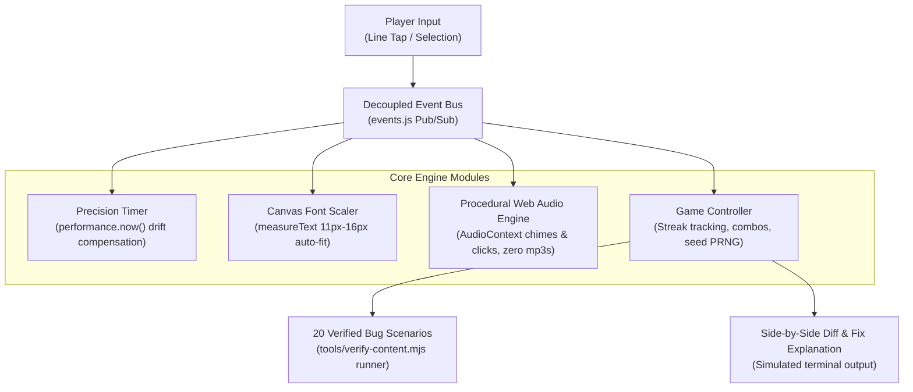

# Catch the AI — Interactive Code Review & Debugging Engine

> **Live Application:** [catchtheai.vercel.app](https://catchtheai.vercel.app/)  
> **Automated In-Browser Test Suite:** [catchtheai.vercel.app/?test=1](https://catchtheai.vercel.app/?test=1)  
> **Author:** [B Pradeep](https://github.com/Pradeep-B28) · [Portfolio](https://pradeep-b28.github.io/Pradeep-B28/)

---

## Overview

**Catch the AI** is a fast-paced developer code-review game where players inspect AI-generated code snippets and identify subtle bugs, off-by-one errors, state mutation side effects, and asynchronous race conditions before the 30-second timer runs out.

Built with vanilla JavaScript (ES modules) featuring a decoupled publish/subscribe event bus, procedural Web Audio API sound synthesis, canvas-measured dynamic font fitting, and zero build tool overhead.



---

## Architectural Highlights

| Feature | Technical Implementation |
| :--- | :--- |
| **Decoupled Event Bus** | Screens and components communicate exclusively through a centralized publish/subscribe bus (`js/events.js`), preventing DOM coupling. |
| **Drift-Free Precision Timer** | 30-second countdown calculates actual elapsed time via delta `performance.now()` stamps rather than drifted `setInterval` ticks; automatically pauses when `visibilitychange` fires. |
| **Dynamic Canvas Font Fitting** | Measures snippet line lengths via canvas `context.measureText()` and scales monospace font dynamically between 11px and 16px to prevent horizontal line wrapping. |
| **Procedural Sound Engine** | All click sounds, countdown ticks, and victory chimes are synthesized directly in code using the native Web Audio API oscillators—zero external MP3/WAV assets required. |
| **Automated Bug Verification** | All 20 AI bug scenarios are accompanied by unit tests in `tools/verify-content.mjs` verifying both failure on buggy code and pass on corrected fixes. |

---

## Core Game Flow

1. **Prompt & Specification Review:** The player inspects what the AI was prompted to write.
2. **Defect Identification:** The player identifies and taps the faulty line under a 30-second countdown.
3. **Execution Diff & Concept Mastery:** Upon selection, an interactive diff view explains the exact defect (e.g. object reference mutation, unawaited promise, index boundary error) alongside simulated terminal execution output.

---

## Automated Verification Harness

Every snippet in the game is validated by a headless Node.js test harness:

```bash
# Verify all 20 bug and fix scenarios
node tools/verify-content.mjs
```

Or run the client test suite directly in your browser:
```
https://catchtheai.vercel.app/?test=1
```

---

## Local Development Setup

No build step, transpiler, or bundler is needed.

1. **Clone the repository:**
   ```bash
   git clone https://github.com/Pradeep-B28/Catch_The_AI.git
   cd Catch_The_AI
   ```

2. **Serve with any local static HTTP server:**
   ```bash
   # Using Python 3
   python -m http.server 8000

   # Or using Node npx
   npx serve .
   ```

3. **Open in browser:**
   ```
   http://localhost:8000
   ```

---

## License

This project is licensed under the [MIT License](LICENSE).
